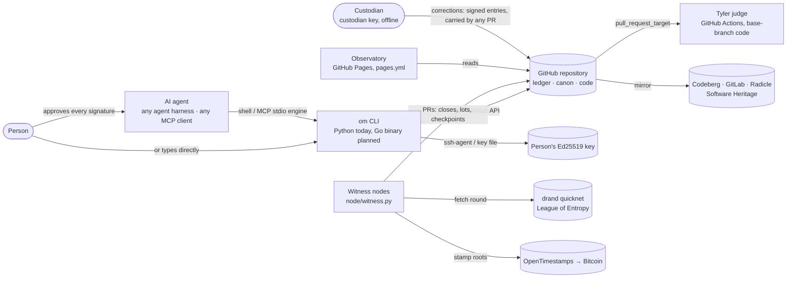
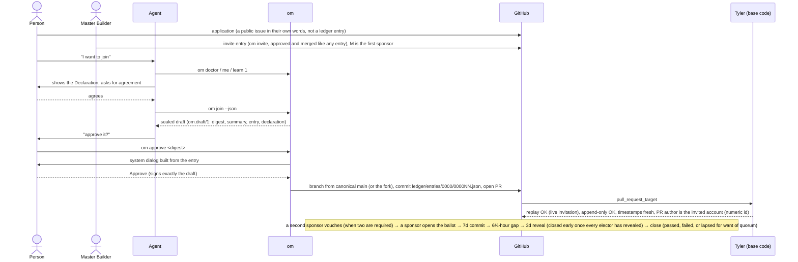

# OpenMasonry Architecture

**Status:** v1 draft · **Owner:** not a governed file: it changes by code-owner review
**Normative companions:** [SPEC.md](../whitepaper/SPEC.md) (the exact protocol rules), [WHITEPAPER.md](../whitepaper/WHITEPAPER.md) (their intent), [CONSTITUTION.md](../../CONSTITUTION.md) (governance), [CUSTODIAN.md](../governance/CUSTODIAN.md) (the Custodian's charter), [RECOVERY.md](../operations/RECOVERY.md) (runbooks), [ROADMAP.md](../../ROADMAP.md) (sequencing), [PRIOR-ART.md](../research/PRIOR-ART.md) (about 60 systems and papers behind these choices: Radicle, git-bug, Sigstore, Certificate Transparency, drand, MACI, Belenios, Hats, Colony, Aragon, Moloch, Optimism RetroPGF, Gitcoin, BrightID, Proof of Humanity, Flanigan et al. 2021, MCP, AGENTS.md, Agent Skills)

This document describes how the system is built: the pieces, their boundaries, how they talk, and why. It is the map a contributor (human or agent) needs before touching code. Protocol rules live in the specification, and the whitepaper explains them; this file only explains where each rule is implemented and how the parts cooperate.

---

## 1. Goals and constraints

### 1.1 What the architecture must deliver

| # | Goal | Measured by |
|---|---|---|
| G1 | **Anyone can verify everything**, offline, from genesis | one command, exit code, identical result on every OS |
| G2 | **Anyone can take part through an agent** (any agent harness or MCP client) or by hand | a person joins with ≤ 5 approvals and no protocol knowledge |
| G3 | **No one, including the founder, the Custodian or a maintainer, can change the rules unilaterally** | protocol code, canon, Constitution and the two charters are pinned and judged by base code; no correction changes a governed file or a pin |
| G4 | **Runs without anyone awake** | witnesses close ballots, draw lots, checkpoint and anchor on their own |
| G5 | **Survives the loss of any single host** | ≥ 3 mirrors, host-independent ledger, anchors on Bitcoin |
| G6 | **Fast enough for a large fraternity** | replay of 100,000 entries in < 5 s on a laptop (Go, native Ed25519) |

### 1.2 Constraints that come from the Landmarks

| Landmark | Architectural consequence |
|---|---|
| II Light, not Secrecy | All state is public files; no private database; no server is authoritative. The study rooms of the degrees are closed conversation outside the state and carry no authority (§8) |
| III Nothing for Sale | The protocol never reads a blockchain, token or payment. Patron Seals are ledger entries that no eligibility, electorate or Light function may read, enforced by a conformance test ([SEALS.md](../whitepaper/SEALS.md)) |
| IV One Member, One Vote | No code path weights a vote by degree, Light, seal or seniority |
| V No Permanent Power | Every office (a seat held by election, lot or naming, Constitution II.7) has a term; the ledger enforces it for the seats of the Supreme Council and for each custodian key, and the rest are procedural; a degree's duty is not an office, and a witness key is removable by ballot at any time. A member who stops taking part is dormant: no longer counted in quorums and turnouts, and still holding the vote |
| VI Verifiable Law | Every rule that binds members is text (the Constitution, the canon, SPEC), and code wherever the ledger enforces it (the pinned core). The conformance vectors are shared, so that the planned second implementation (Go `om`) must agree with the Python reference. The ledger is append-only: no entry is ever rewritten or erased. A repair made by an office is itself an entry, a correction, which may undo, freeze or pause and never grant (§6.6); a key recovery by peers and a reinstatement by sanction ballot are not repairs by an office |
| VII Exit and Fork | Everything needed to fork (code, ledger, canon history, anchors) is in the repository |

### 1.3 Non-goals

A custom blockchain or consensus network. Anonymous membership. Any server that a member must trust. Any ordinary act that requires the founder: admissions, examinations, ballots, lots and amendments run without any office. The one office a founder holds, the Custodian, can only repair (§6.6), and it ends by rule.

---

## 2. System context (C4 level 1)



| Actor / system | Trust placed in it | If it misbehaves |
|---|---|---|
| Person | owns their key | only their own acts are affected |
| AI agent | none: it proposes, the person approves, `om` enforces | at worst proposes a refused entry |
| `om` / Python verifier | open source; one implementation today, a second (Go) and reproducible builds planned (v0.2) | every witness and every member who replays disagrees |
| GitHub | availability only | mirrors take over; history cannot be forged (§7) |
| Tyler (CI) | runs base code, reads PR as data | a bypassed merge is caught by daily re-verification and witnesses |
| Witnesses | liveness; their checkpoints state the digest of the whole state (no rule derives finality from them; Byzantine finality is planned, §9.3) | another witness or any member performs the same due actions; a Custodian can freeze a witness key for 30 days |
| Custodian | a bounded power to repair: freeze, stay, halt, hold and, after 14 days of notice, void or undo; never to grant, and never over an amendment, its own removal, a witness addition or an advancement to the 3rd degree | every act is a public entry with a ground and a reason; Master Builders void it by objection and remove the key by simple majority; the revoke key ends it at once; every key ends at the Sunset and at the latest seven years after it was named. Before other Masters exist: publicity and the fork |
| drand | unpredictability of the lot | needs a threshold of League of Entropy members to collude |
| OpenTimestamps / Bitcoin | public clock | calendars can only withhold, never forge |

---

## 3. Containers (C4 level 2)

```
 ┌──────────────────────── om (Go, single static binary, PLANNED) ──────────────────────┐
 │  cmd/om ── cobra commands ── internal/app (use cases) ─┬─ protocol/  (pure core)       │
 │                                                        ├─ sshsig/    (Ed25519, SSHSIG) │
 │  om mcp ── MCP server (planned) ───────────────────────┤  store/     (ledger files)    │
 │                                                        ├─ govern/    (pins, digests)   │
 │  om witness run ── loop (planned) ─────────────────────┤  beacon/    (drand + BLS)     │
 │                                                        ├─ anchor/    (OpenTimestamps)  │
 │                                                        ├─ forge/     (GitHub/Codeberg) │
 │                                                        └─ vault/     (local salts)     │
 └───────────────────────────────────────────────────────────────────────────────────────┘
 ┌─ src/openmasonry (Python 3.11+, stdlib) ─┐  ┌─ .github/workflows/ ──────────┐  ┌─ Observatory ────┐
 │ reference verifier = executable spec     │  │ judge.yml: base code, PR data │  │ public page from │
 │ conformance-vector generator             │  │ tyler.yml: audit main, tests  │  │ the ledger       │
 │                                          │  │ pages.yml: the Observatory    │  │                  │
 └──────────────────────────────────────────┘  └───────────────────────────────┘  └──────────────────┘
```

| Container | Language | Responsibility | Status |
|---|---|---|---|
| **Python reference** (`src/openmasonry`) | Python 3.11+, stdlib | executable specification; generates conformance vectors; judge in CI until `om` passes them. Two parts (below): the **pinned core**, which decides validity, and the command line and tools around it, which do not | shipped (v0.1) |
| **`om`** (`cmd/om`, `internal/…`) | Go ≥ 1.23 | the tool for people, agents and witnesses: verify, act, MCP, witness loop | Roadmap v0.2 |
| **Tyler** | GitHub Actions YAML | gate on every PR, daily full re-verification | shipped |
| **Witness image** | Docker (`node/`) | runs `node/witness.py` with a baked, pinned verifier (`om witness run` in Go later) | shipped (Python), Go in v0.2 |
| **MCP engine** (`engines/openmasonry`) | TypeScript, built on the official MCP SDK (`@modelcontextprotocol/sdk`, pinned in `engines/openmasonry/package.json`; [decision 11](#decision-11-mcp-engine)) | MCP access for agents: local stdio (reads + sealed drafts, never signs) and a public read-only HTTP endpoint; every rule stays in `om` | shipped (v0.2 read path) |
| **Observatory** | static HTML/JSON on GitHub Pages | the public view, computed from the ledger (and, for the rooms, from the access the room sync publishes): members by degree, ballots, the admission funnel, witnesses, every correction and its state, the roll of each room. Anyone can reproduce its numbers. Built (`bin/om observatory --out DIR`, `metrics.py`, `observatory.py`); its workflow, `.github/workflows/pages.yml`, is part of the pinned core ([ops/observatory/README.md](../../ops/observatory/README.md)) | built; published once GitHub Pages is on |
| **Console** | a local web app on the Custodian's machine, outside this repository | the private view of what GitHub shows only to an administrator (settings drift, failed runs, owners and apps, room sync). Its data sources and limits are public: [CONSOLE.md](../governance/CONSOLE.md). It never reads the content of a room. It is a working tool that decides nothing: every output that binds is a public entry, issue or file | built, private; operates from the public launch |
| **Room sync program** | Python, run on a schedule | derives the readers of each room from the ledger and applies them to the 33 rooms (private repositories of the organization `openmasonry-org`); refuses to act when the ledger fails verification. The rule is `rooms.py`, pinned (SPEC §15); the program is `ops/rooms/sync.py`, run from the private `ops` repository through a GitHub App; on every run it writes, and its workflow publishes to the public repository named by `ROOMS_PUBLIC_REPO`, the access the host actually grants (the readers of each room, the owners of the organization and every installed application) and an anonymous log of its runs ([ops/rooms/README.md](../../ops/rooms/README.md)) | built; runs once the rooms open |
| **Patron Seals** | ledger entries (`seal`, `treasury_out`) + fiat fiscal host | recognition of donations; no protocol function may read them | v0.7, see SEALS.md |

**The Python package today.** `src/openmasonry/` is flat, and split by what is pinned:

```
src/openmasonry/
  ── the pinned core (`@protocol`, the files listed in protocol.manifest): changes only by amendment ──
  __init__.py     package marker (empty)
  ledger.py       replay: every rule (members, ballots, exams, custodians and corrections, key rotation and
                  recovery, the effective clock); the strict loader; the state document and its digest; the
                  verdict on the verified head; building and signing the next entry
  crypto.py       canonical JSON, SHA-256, RFC 6962 Merkle root; Ed25519 and the SSHSIG format verified in pure
                  Python for both key types (ssh-ed25519 and the hardware-backed sk-ssh-ed25519@openssh.com);
                  signing calls ssh-keygen
  canon.py        constants; degree tables by digest
  lot.py          the lot
  govern.py       reading the manifest of a tree, the @protocol digest, check_tree (pins, the closed set of
                  workflows, the public reasons of corrections)
  identity.py     gate: pull request author, key listing (petition, rekey, key recovery), invited account,
                  the member's own account
  beacon.py       gate: public drand beacons
  rooms.py        the rule of the rooms (SPEC §15): the roll each room derives from the ledger, and the plan
                  that turns its difference from the room teams into actions; outside replay
  verify.py       the entry point: `python -P -m openmasonry.verify` (the judge, the audit, `om verify`)
  network.toml    the canonical repository
  protocol.manifest  the list of the pinned core: data, one sorted path per line, listing itself
  (+ .github/workflows/judge.yml and tyler.yml: the judge's workflow and the Tyler's; no workflow may exist
     that the manifest does not list)
  ── not pinned: changes by code-owner review ──
  __main__.py     the command line `om`; `om verify` calls verify.py
  actions.py      member commands: drafts, approval dialog, publishing
  onboard.py      `om onboard` and `om apply`: the checks and the application of a person who is not a member yet
  guide.py        next steps for a member
  heraldry.py     coats of arms
  metrics.py      the Observatory's numbers, aggregates only (`om metrics`, `om timeline`)
  observatory.py  the Observatory page and its data (`om observatory --out DIR`)
```

The launchers are `bin/om` (a POSIX shell script) and `bin/om.cmd` (native Windows: it finds Python 3.11+ through `OM_PYTHON`, `py -3` or `python`).

The core imports only itself and the standard library; nothing in it imports the command line. A test reads the manifest, parses the imports of every pinned module and fails on any other (`tests/test_core.py`).

**The manifest is data, read from the tree being judged.** `govern.protocol_digest(root)` and `govern.stray_workflows(root)` read `src/openmasonry/protocol.manifest` of `root`, never a list inside the code. The judge runs the base branch's code on a pull request's tree, so the old code and the new code compute the same digest for the same tree: a change of the core that adds a module or a workflow is ratified first (an amendment pins the digest of the new tree) and then passes the old judge. A manifest changed without that amendment, to add a file or to drop one, gives a digest the ledger does not pin; a malformed manifest makes the tree unlawful. The witness image copies exactly the listed files (`node/Dockerfile`), and the witness signs only while the digest of its own copy is the pinned one.

**Why Go for `om`.** A single static binary for macOS, Linux and Windows with no runtime. The standard library ships `crypto/ed25519`, and `golang.org/x/crypto/ssh` parses OpenSSH keys and signatures. The Python reference already verifies every signature without OpenSSH, in pure Python arithmetic; native Ed25519 makes replay orders of magnitude faster. The official MCP Go SDK exists, and reproducible builds with SLSA provenance are routine. The Python verifier stays as an independent second implementation: two implementations that must agree are the strongest defense of Landmark VI.

---

## 4. The `om` binary (C4 level 3)

### 4.1 Package layout

```
cmd/om/                     main: wires cobra commands to internal/app
internal/
  protocol/                 pure rules only: no I/O, no clock, no network
    types.go                Entry, State, Member, Ballot, Exam, Custodian, Correction, Recovery (mirrors the Python
                            dataclasses)
    canonical.go            canonical JSON (sorted keys, no whitespace, UTF-8, strict parse)
    apply.go                Apply(state, entry, Verifier) error  ← the protocol, one handler per type
    decide.go               Quorum, Decide (the decision function D)
    lot.go                  Draw (sha256 ranking)
    merkle.go               RFC 6962 MTH
    due.go                  DueActions(state, now) ← what a witness owes
  sshsig/                   Ed25519 + OpenSSH SSHSIG behind an interface: hiddeco/sshsig or ~150 lines over
                            x/crypto/ssh until golang/go#68197 lands upstream. Validity is the rule of SPEC §13
                            (one accepted form per signature), tested on the conformance vectors, not the
                            behavior of an installed ssh-keygen
  store/                    read/write ledger/entries (strict names, strict JSON), canon history
  govern/                   pins, @protocol digest (an explicit manifest of files), CheckTree
  identity/                 the judge's online PR check (Python: src/openmasonry/identity.py); its network calls
                            fetch github.com/<login>.keys and api.github.com/users/<login> and fail closed
  beacon/                   drand client; verifies each round's BLS signature offline against the pinned
                            quicknet chain hash and public key (network only fetches missing rounds)
  anchor/                   OpenTimestamps stamp/upgrade/verify
  forge/                    GitHub (REST + gh fallback), Codeberg/Gitea, Radicle adapters
  vault/                    OS keychain or 0600 file under ~/.config/openmasonry/: ballot salts and drafts. Salts never
                            leave om: MCP tools return commitments, never salts
  proofs/                   RFC 6962/9162 inclusion + consistency proofs, C2SP tlog-checkpoint emission
  app/                      use cases: Join, Vouch, Vote, OpenExam, Report, Depart, Verify, WitnessCycle…
  mcp/                      MCP server: tools + resources + prompts mapped onto app use cases
conformance/                the JSON vectors of tests/vectors/: (ledger, expected state digest | expected refusal),
                            generated by the Python reference (SPEC §14)
```

**Pure rules, side effects outside.** `protocol/` is pure and receives the signature verifier as a parameter, exactly as the Python `apply(st, e, verifier)` already does. Everything that touches disk, network, clock or keys lives in the other packages. The rules can therefore be tested exhaustively and fuzzed, and its behavior pinned by conformance vectors.

### 4.2 Command surface

Verbs are the same in the Python wrapper (`bin/om`) and in the Go binary, so instructions written today keep working. **Every command in this table exists today** in the Python reference; planned ones are listed separately below.

Commands marked *drafts* never sign: they check the act against the protocol, store the exact entry as a sealed draft (mode 600, `~/.config/openmasonry/pending/<sha256>.json`) and exit with code 3; `--json` prints it as `om.draft/1` (`digest`, the full sha256 of the entry; `summary`; `entry`; `approve`, an argv; for `join`, `declaration`). Only `om approve` signs, after the person confirms in a system dialog.

| Command | What it does | Signs? | Public? |
|---|---|:-:|:-:|
| `om onboard [--create-key [PATH]] [--use-key PATH] [--upload]` / `om apply --text FILE [--check] [--web]` | for a person who is not a member yet: every check of the machine, the GitHub login and the member key, the stage and the one next step (`om.onboard/1`); the key made in the person's own terminal and uploaded as an authentication key after a dialog / the person's own application published as a public issue after a dialog (`om.apply/1`) | no | the upload and the application, after the dialog |
| `om doctor` | checks Python, OpenSSH, git, `gh` and login, the key (Ed25519, plain or held by a hardware token), the key listed at `github.com/<login>.keys`, ssh-agent, the ledger, whether the configured key is the one the ledger holds for the member (if not, it explains `om rekey`), and whether the clone is in sync / behind / ahead / diverged from the canonical repository | no | no |
| `om verify [--tree] [--online] [--clock-since SEQ] [--pr-author LOGIN --since SEQ [--pr-author-id N]] [--root DIR] [--json] [--accept-genesis HASH]` | replay from genesis; governed files and the closed set of workflows; drand audit; entries from `SEQ` on must be fresh (CI passes the base length); with `--pr-author` and `--since` (always together), the online identity check of a pull request (§7; `--pr-author-id` is the author's numeric GitHub id, as the pull request event gives it). With `--online` it also refuses a last entry dated ahead of the clock. On this repository's own ledger it then holds the canonical ledger against the head this clone verified earlier (`ROLLBACK`, `BEHIND`, `FUTURE HEAD`; `--accept-genesis` follows another genesis or a fork from now on, and is the person's decision). The JSON report (`om.verify/1`) carries `state_sha256`, the digest of the state replay reached. It calls the pinned verifier; CI runs that directly as `python -P -m openmasonry.verify` with the same flags | no | no |
| `om state [--json]` / `om me [--json]` | members, degrees, open ballots, custodians and the date their next sign of life is due, corrections, key recoveries, a halt (`om.state/2`); the person's own view and due steps (`om.me/2`) | no | no |
| `om corrections` / `om witnesses` | the public record of every correction: act, target, ground, reason, state, objections (with the notes, it is the moderation log) / each witness, its key's fingerprint, its latest checkpoint and any freeze | no | no |
| `om learn [<degree>]` / `om rules <topic>` | the curriculum page; where a rule is written | no | no |
| `om genesis [--github-id N] [--cofounder L:KEY.pub[:ID]] [--witness N:KEY.pub] [--custodian …]` | drafts the Founding Ceremony (entry 0); each founder is recorded with a numeric GitHub user id (asked of GitHub with `gh` when not given); `--custodian` names a Custodian with its custodian key and its revoke key, each of which signs a proof of possession ([LAUNCH.md](../operations/LAUNCH.md)) | drafts | drafts |
| `om invite <login> [--github-id N]` | drafts an invitation to petition (3°+): the inviter becomes the candidate's first sponsor; it lapses after 30 days without a petition (the numeric GitHub user id is asked of GitHub with `gh` when not given) | drafts | drafts |
| `om join` | drafts the petition with the bare key and the Declaration hash (the draft carries the Declaration's text); it needs a live invitation for the login, and refuses without one, explaining how to apply | drafts | drafts |
| `om vouch <login>` | drafts a further sponsorship of an invited candidate's petition (3°+; the inviter already sponsors) | drafts | drafts |
| `om open <kind> <target> [--rerun ID] [--commit-days N --reveal-days N]` | drafts a ballot opening (admission, advancement, sanction, amendment, witness; and `om open custodian NAME`, the ballot by which the Master Builders remove a custodian key); `--rerun` re-runs a ballot that lapsed for want of quorum (once, within 30 days); only an amendment takes its own windows | drafts | drafts |
| `om vote <ballot>` / `om reveal <ballot>` | drafts a sealed vote (Yes/No chosen in the approval dialog; salt and vote in the local vault, mode 600) / its reveal (vote redacted in the draft) | drafts | drafts |
| `om close <ballot>` | drafts the close of a ballot whose reveal window ended, or whose electors have all revealed | drafts | drafts |
| `om exam <n> --work <url>` / `om report <cand> <n> pass\|fail [--reason <url>]` / `om recuse <cand> <n>` | open your exam (beacon round computed) / a drawn examiner's verdict / recusal | drafts | drafts |
| `om draw [--candidate L]` / `om call-council` | a due lot with the drand beacon / the Supreme Council call | drafts | drafts |
| `om work <url>` / `om depart` | record a masterwork / leave (Landmark VII) | drafts | drafts |
| `om rekey --new-key PATH` | drafts the replacement of the member's own key by the key at `PATH` (plain or hardware-backed). Nothing is signed at the draft. On approval the dialog shows the fingerprints of the old and the new key; then the new key signs the proof and the current key signs the entry (two signatures; a hardware key asks for a touch). After approval the local configuration (`~/.config/openmasonry/config.json`) names the new key, which signs from then on (`--key` and `OM_KEY` still take precedence). Once in 30 days; never a due step | drafts | drafts |
| `om recover …` | the commands of a key recovery through peers (`recover`, `recover-cosign`, `recover-oppose`, `recover-object`, `recover-apply`): the request with the new key, a Master Builder's co-signature or opposition, the old key's objection, and the application after the notice of 21, 30 or 45 days ([RECOVERY.md](../operations/RECOVERY.md)) | drafts | drafts |
| `om claim-custodian` / `om object-claim` / `om apply-claim` / `om claim-succession` | a founder's claim of the Custodian office while no custodian key is live (never by a founder against whose custodian key a removal ballot passed), a non-founder Master's objection to it, its application after 30 days; a succession claim by a member below the 3rd degree when no active Master Builder is left | drafts | drafts |
| `om object` | drafts a Master Builder's objection to a correction | drafts | drafts |
| `om correct …` / `om alive` | the Custodian's commands, signed with the custodian key: a correction (an act, a target, a ground of the closed list, and the public reason archived under its SHA-256 in `ledger/reasons/`) and the entries that follow one; the sign of life | drafts | drafts |
| `om alarm <title> <body>` | drafts a public issue on the canonical repository | no | drafts |
| `om approve <digest> [--no-submit]` | the **person** confirms in a system dialog built from the entry; signs exactly that draft and opens the PR from the canonical `main` (via the member's fork without write access) | ✔ | ✔ |
| `om drafts` / `om discard <digest>` | list / drop pending drafts | no | no |
| `om pending [--drop SEQ] [--rebase [SEQ]] [--publish SEQ]` | own signed entries waiting for their PR (new drafts wait for them) or `stale` (another entry took their seq; they block no draft); `--drop` forgets an abandoned one and frees its vote; `--rebase` re-drafts a stale one (the only one, or `SEQ`) on top of the ledger with the same body, a vote keeping its sealed choice, to be approved again; `--publish` pushes the branch of a signed entry whose push or pull request failed and opens the pull request (asks the person) | drafts | drafts |
| `om submit` | publish entries signed with `--no-submit` (asks the person) | no | ✔ |
| `om append`, `om commit`, `om declaration`, `om digest`, `om arms`, `om docs` | low-level tools: sign one entry (witnesses, tests), a commitment, the Declaration hash, the `@protocol` digest, coats of arms, the degree catalog | `append` | no |

**Planned (not in `bin/om` yet):** `om witness run` (the witness loop of §6.4, today `node/witness.py`), `om mcp` (an MCP server inside the Go binary, §5.3; today the MCP engine fills that role), and `om status`. The Observatory's commands (`om rooms`, `om metrics`, `om timeline` and `om observatory`) are in `bin/om`.

The approval dialog is native (`zenity --no-markup` or escaped `kdialog` on Linux, `osascript` on macOS, a PowerShell window on native Windows) and falls back to a code typed on `/dev/tty` (the console on Windows); on macOS only the Cancel button cancels. Every field of the entry is shown, cleaned of control characters. Only drafts for this repository's ledger, signed with the act's own key, can be approved. The test bypass needs `OM_CONFIRM`, a marker file in `OM_HOME`, an `OM_HOME` under the system temporary directory, a signing key inside that `OM_HOME` (never under `~/.ssh`) and a scratch ledger, so it is never honored on the repository's ledger or with a real key. Publishing refuses a stale, ahead or diverged clone. The member's own signed entries stay visible locally (an outbox overlay) until their PR merges; one whose seq another entry took becomes `stale` and is kept for `om pending --rebase`.

### 4.3 Keys

- **Never in the agent's context.** `om` signs through `ssh-agent` (recommended with `ssh-add -c`, so the OS asks the person to confirm each use) or a key file path. It never prints or copies private keys.
- **Two key types, both bare**, the same key the person lists on GitHub: `ssh-ed25519 <base64>`, and `sk-ssh-ed25519@openssh.com <base64>`, an Ed25519 key held by a hardware token (application `ssh:` only). A key has one text form (the base64 must be the canonical encoding of the exact key blob), and two keys with the same 32 bytes are one key, whatever their types. Hardware-backed keys are recommended for founders, witnesses and Master Builders.
- **Signatures of both types are verified in pure Python** (`crypto.signature_valid`): for a hardware-backed key, OpenSSH's security-key format, with the token's flags and counter inside the signed data and the user-presence flag required. Signing still calls `ssh-keygen -Y sign`, which asks the token for the touch. No attestation is recorded: the ledger checks signatures, not hardware.
- **Rotation**: a `rekey {key, proof}` entry signed by the old key, with a proof signed by the new key over the login, the old key and the new key. The new key must never have appeared in the ledger; one rekey per member in 30 days; a suspended member may rekey. The judge requires the new key to be listed at `github.com/<login>.keys`.
- **Recovery** of a key that is lost or in other hands goes through peers, and never needs a custodian. The member asks with a new key (`rekey_recover`, signed by the new key, from the member's own GitHub account, with a key that account lists). After a custodian's freeze of the old key (a correction, ground `key_compromised`), two Master Builders co-sign (`rekey_cosign`) and 21 days of notice run from the request. Without a freeze (an **open** recovery), three co-sign, not all of them the member's sponsors while an active Master Builder who is not a sponsor exists, the notice of 30 days starts at the last co-signature and freezes the old key, and the Master Builders may oppose it (`rekey_oppose`). Never more co-signers are asked than other active Master Builders exist, counting only those who revealed a vote or reported within the last year or reached the 3rd degree within it, and a lowered number means 45 days of notice; a request that still lacks co-signers 30 days after it was made needs only those who signed (at least one), who may then all be sponsors, with 45 days of notice: after a freeze they start on that thirtieth day and the old key stays frozen meanwhile; without one, they start on that thirtieth day if the co-signatures then given are enough, and otherwise at the co-signature that makes them enough. Whoever holds the old key can stop a recovery once, while it is open (`rekey_object`); the request that follows, no sooner than 90 days after the stop, is final: the old key cannot stop it. The new key completes it (`rekey_recover_apply`) within 60 days of the start of the notice; a recovery reverses a departure when it is asked before the departure or within 30 days of it, or when it follows, within 150 days of that recovery's request or of the old key's stop of it, a recovery in time for that departure, whatever ended that recovery, so one follow-up may follow another; it does so when it completes, and a Council seat the departure ended comes back only into a vacancy. Revocation of a key by ballot and attestation of hardware-backed keys are planned.
- **A Custodian holds three keys**, generated and stored apart: the member key; the custodian key, offline, which signs corrections and the sign of life and nothing else; and the revoke key, offline and elsewhere, whose one power is to remove the custodian key at once. Both custodian keys are named, each with a proof of possession, in the genesis or in a founder's claim, belong to no GitHub account and never change: a founder's claim names a new custodian with new keys.

---

## 5. The agent interface

The goal is that a person can say *"help me join OpenMasonry"* to any agent and be guided safely, without the agent knowing anything beforehand.

### 5.1 Discovery: four layers, cheapest first

| Layer | File | Read by |
|---|---|---|
| 1 | [`AGENTS.md`](../../AGENTS.md): lanes and ground rules in one screen | any agent harness that reads AGENTS.md |
| 2 | [`llms.txt`](../../llms.txt): curated index of the docs | LLM browsers and retrieval tools |
| 3 | [`skills/om*/SKILL.md`](../../skills/om/SKILL.md): the **officers** as Agent Skills, already linked in the clone's agent skills folders (`.agents/skills/` and its equivalents) | any SKILL.md-aware agent; in a clone the person just asks or types `/om` |
| 4 | the MCP engine ([`engines/openmasonry/`](../../engines/openmasonry/README.md)): MCP with typed tools (`om mcp` in the Go binary later) | any MCP client (desktop and editor agents) |

A person can also paste [GLOBAL-SNIPPET.md](../agents/GLOBAL-SNIPPET.md) into a global instructions file. Nested `AGENTS.md` files in `ledger/` and `canon/` state the local rules (append-only; governed files), and further skills per task (`om-petition`, `om-vote`, `om-witness`, `om-masterwork`) are planned.

The member's MCP server speaks **stdio** (no network listener), following the MCP security guidance: no credential passthrough, consent before side effects. The only network endpoint is the public, anonymous, read-only one.

### 5.2 The officers: agents for members

A person never has to learn the protocol. They talk to their own agent, which plays the lodge's officers. Each officer is a harness-agnostic playbook (`skills/<name>/SKILL.md`) that drives `om`:

| Officer | Skill | In the lodge | Here |
|---|---|---|---|
| **Guide** (orchestrator) | `om` | leads the candidate through each step | reads `om me --json`, offers the due steps as choices, explains, drafts, asks for approval, acts, then calls the other officers when their field comes up |
| Counselor | `om-counselor` | explains the rules and helps members understand their rights | sourced opinions on lawfulness: Landmarks → code → whitepaper [N] → Constitution |
| Secretary | `om-secretary` | minutes and the membership roll | bulletins of what changed, deadlines, Light and dormancy (never rankings), minutes, wiki upkeep |
| Wardens | `om-wardens` | help members study each degree and examine masterworks | study plans per degree, review of masterworks (never ghost-writing), rubric for drawn examiners |
| Almoner | `om-almoner` | cares for members | pauses, overload, leaving with dignity, someone missing, relief (v0.7) |
| Tyler | `om-tyler` | guards the door; the 30° Watch | `verify --tree --online`, alarms, suspicious patterns, key compromise |

**Interaction contract (all officers).** Look first (`om doctor`, `om me --json`). Offer choices with the harness's structured question tool (or a numbered list when there is none). Explain and answer questions. Draft the act (`om <command> --json`: a sealed draft, exit 3, nothing signed). Ask; then the person runs `om approve <digest>` and confirms in a system dialog that only they can answer (for a vote, they choose Yes or No there, so the agent never learns it). If your agent's harness times out long-running commands, the person runs `bin/om approve <digest>` in their own terminal. The human-in-the-loop is enforced twice: by the officer's playbook and by `om` itself, which signs only after the dialog.

**The Guide's brain is pure code.** `openmasonry.guide.next_steps(state, login, now)` computes the due steps (apply, join, find sponsors, sponsor, open admission, vote, reveal, close, draw, call the council, report, study, exam, advance, keep alive…) (inviting is never a due step: whom a Master Builder invites is theirs alone to decide) and `om me --json` publishes them as `om.me/2`: `member`, `invitation` (the person's live invitation: `by`, `github_id`, `expires_at`; else `null`), `founding_phase` (boolean), `canon_pending` (the sha256 of a ratified degree canon whose text `canon/history/<sha256>.toml` this clone lacks, else `null`; the steps then degrade to a `wait` asking for `git pull`), `pending_prs` and `stale` (each `{seq, type}`) and `steps[]`, each with `action`, `why`, `argv` (a list, never a shell string), `needs` (the person's inputs, appended in order), `choices`, `due_by` (act before), `opens_at` (possible from) and `public`. Every harness therefore sees the same truth, and the logic is tested like the protocol.

### 5.3 MCP surface (the MCP engine today, `om mcp` later)

**Today: the MCP engine** ([`engines/openmasonry/`](../../engines/openmasonry/README.md), [decision 11](#decision-11-mcp-engine)). It never implements a rule: every capability calls `bin/om` with `execFile` (no shell, strict input patterns, `--` before free text) and parses a versioned JSON contract (`om.me/2`, `om.state/2`, `om.corrections/1`, `om.verify/1`, `om.degree/1`, `om.rules/1`, `om.draft/1`, `om.drafts/1`). Over MCP, tool names use `_` instead of `.`.

**Additive fields.** `om.me/2` carries `invitation`, `founding_phase`, `canon_pending` and `stale` beside `member`, `pending_prs` and `steps`; `om.state/2` carries `founding_phase`, `masters` (the count of active Master Builders, 3°+), `canon_pending`, `invitations` (the live ones), `custodians` (name, member, status, last sign of life and the date the next is due, an open removal ballot), `custodian_threshold`, `sunset`, `corrections` (each with its status, objections, signers and, for a noticed act, the end of its notice and of the time to apply it), `recoveries` and `halt` beside `name`, `head`, `entries`, `members`, `open_ballots`, `exams`, `petitions` and `checkpoints`. Members and petitions (and, in `om.me/2`, `member`) carry `github_id`; a member also carries `frozen_until`, `room_hold_until` and `recovering`, and an open ballot `stayed_until`, with its windows shown where they fall as things stand. In `om pending --json` (`om.pending/1`, which the engine does not call), each item's `state` is `stale`, `dropped` or the PR's state (`OPEN`, `MERGED`, `CLOSED`, `unknown`). Fields are added under the same schema names: clients ignore fields they do not know.

| Composition | Transport | Tools | Who |
|---|---|---|---|
| local | MCP stdio, principal `local:<login>` fixed at startup | `member_due-steps`, `ledger_status`, `ledger_verify` (online allowed), `corrections_read`, `degree_read`, `rule_sources`, `entry_draft`, `entry_pending` | the member, inside their clone |
| public | MCP Streamable HTTP, anonymous by design | the same six reads (`member_due-steps` takes a `login`), offline verify only; at most 2 `om` processes at a time, identical reads cached for 30 s | anyone; beside a witness |

`entry_draft` takes an `act` named like the Guide's step actions (`join`, `sponsor`, `vote`, `reveal`, `open_admission`, `advance`, `close`, `exam`, `report`, `recuse`, `draw`, `call_council`, `work`, `depart`, `open_sanction`, `open_amendment`), plus `invite`, which is never a step: it is drafted only when a Master Builder names the person, and `object` (a Master Builder's objection to a correction), drafted only when the person asks. A vote carries no value. `entry_pending` lists the person's sealed drafts. There is **no** approve, sign or submit tool: only `bin/om approve`, in the person's dialog, signs.

**Planned: `om mcp`** in the Go binary, with resources (`om://state`, `om://me`, `om://degrees/{n}`, `om://ballots/{id}`, `om://wiki/{slug}`), read tools (`status`, `verify`, `explain_rule`, `inclusion_proof`, `my_duties`), draft tools and guided prompts (`join`, `vote`, `advance`, `examine`). It keeps the same rule: drafting is free; signing happens only through the person's approval enforced by `om` itself, never by tool annotations alone.

### 5.4 Prompt-injection posture

Ledger bodies, petitions, issues and wiki pages are attacker-controllable text. `om` returns them inside clearly delimited data fields and never as instructions. MCP tool descriptions say so. No tool executes content from the ledger.

---

## 6. Key flows

### 6.1 Join



### 6.2 Ballot (commit–reveal)

The person chooses Yes or No in the approval dialog of `om approve`, so the agent that drafted `om vote <ballot>` never learns it. The commitment `sha256(id|login|vote|salt)` is computed locally at that moment; salt and vote go to the local vault (mode 600, written only after signing; a re-vote is refused) and the reveal reminder to `om me`. The reveal draft redacts the vote. Reveals are accepted only after `commit_until + REVEAL_GAP` (`CLOCK_TOLERANCE + 15 minutes`), so no backdated commit can follow a public reveal. A ballot may be closed as soon as every elector has revealed; one whose votes miss the quorum of its present electors lapses, penalizes nobody and may be re-run once, unless it gave less than 7 days to commit (it is then opened again as a new ballot, which waits for every elector). Encrypted ballots are planned to replace public reveals (§9.1).

### 6.3 Examination and lot

```
 candidate                         ledger                                drand
    │ exam_open (beacon_round = now+9600)│  pool + k frozen now                │
    │───────────────────────────────────►│                                      │
    │                                    │            8 hours later: round R ────┤
    │                       witness: exam_draw{beacon=randomness(R)} ◄───────────┤
    │                                    │  examiners = Draw(pool, k, beacon)   │
    │  examiners: exam_report ×k (≤ 60 days) → member: ballot_open(advancement) │
```

The lot is drawn within 7 days of its round, or the exam lapses. An exam with no verdict after 60 days (on the effective clock) times out with no penalty, and the silent examiners are left out of the next pool whenever anyone else can be drawn, and that next lot seats everyone any rung holds. When no rung of the examiner ladder holds as many members as the degree asks for, everyone any rung holds is drawn together and the number of examiners is lowered to them, in any phase.

### 6.4 Witness cycle

1. fetch + fast-forward; if not in sync, **verify only**;
2. replay with the **verifier baked into the image** (never the freshly pulled code); raise a capture alarm, and sign nothing, when the last entry is dated ahead of the clock (`FUTURE HEAD`) or `main` no longer holds the entry this node verified earlier (`ROLLBACK`; the node remembers its verified head in a file beside its clone, and only waits when `main` is merely shorter);
3. if a previous PR of its own is still open: when that PR can no longer merge (GitHub reports a conflict, or its branch no longer only adds entries on top of `main`, because another entry took its place in the sequence), close it and go on; otherwise verify only (never fork the chain);
4. `CheckTree`: refuse to sign, and raise a capture alarm, if governed files differ from ratified pins; then compare the `@protocol` digest of the image's own code with the ledger's pin, and refuse to sign if they differ (it still verifies and still raises alarms);
5. execute `DueActions(state, now)`: close ballots, draw lots (fetch the drand round; the offline check of its BLS signature comes with the Go binary). During a halt it draws nothing and closes nothing but an amendment ballot or a ballot that removes a custodian; its checkpoints go on;
6. checkpoint `{upto_seq, head, state_sha256, state_version, root}` (every entry so far, and the digest of the state they leave), only when an entry other than a checkpoint was applied since its last one and that one is at least an hour old, and stamp `root` with OpenTimestamps;
7. push a branch and open an auto-merging PR (it creates its `witness` and `capture-alarm` labels and reports when auto-merge is unavailable); the Tyler judges it like any other.

Today this loop is `node/witness.py`; `om witness run` in the Go binary is planned.

### 6.5 Amendment (rule change)

```
 issue (discussion) → for canon/degrees.toml only: a PR archiving canon/history/<sha256>.toml (the opening is refused without it)
   → ballot_open{amendment, path, new_sha256} (a Master Builder; windows 2–30 / 1–14 days) → 2/3 of votes, 1/3 turnout
   → ballot_close: pin moves; the previous pin stays lawful until the text lands
   → PR with the new text → Tyler: tree matches the new pin
```

The slot of an amendment is its path and its text: two texts of one path may be open together, and the first to pass moves the pin, so the other fails at its close because its base pin changed; an amendment whose path has, by its close, become a case twin of a governed path (the same path but for letter case) fails too. An amendment that pins sixty-four zeros removes the pin of a path a passed amendment made governed; the six genesis pins are never removed. Every passed amendment of `@protocol` adds one to the protocol epoch (`S.epoch`), but a rule change never branches on the epoch alone: the voted text of the new core states a fixed future time or `seq` from which the new rule applies, so the entries already merged replay as before. A change of the core is checked before it merges by the `candidate` job of `tyler.yml` (`verify --candidate-root`): the candidate core must replay the ledger to the same head and the same state digest.

For `@protocol`, the new digest is `om digest` over the proposed code (the files of the pinned core, which include the three workflows; a change to any other code needs no amendment). Witness operators rebuild their image only after the pin moves, so new code never runs with a witness key before it is ratified; and once the pin has moved, a witness still running the previous core signs nothing until it is rebuilt.

### 6.6 Correction (repair without rewriting)

```
 immediate act (freeze_key 30 d · freeze_witness 30 d · stay 14 d · halt 14 d · hold_room 14 d)
   custodian key: correction{act, target, ground, reason_sha256} + ledger/reasons/<sha256>.md
     → in force from its entry; ends by itself, by withdrawal, by objections, or with the key that signed it

 noticed act (void_ballot · undo_ballot)
   correction (posted) ──14 days of notice──► correction_apply within the next 7 days, or never
     → every condition is checked again at the application; an undo is compare-and-swap, all or nothing

 Master Builders:  correction_object ×⌈E/5⌉ (never fewer than 1)  → the correction is void for good (an applied noticed act is not reversed)
                   ballot_open{custodian, remove: NAME} → simple majority → the key signs nothing more
 revoke key:       custodian_revoke → the same, at once
```

A correction writes one record and nothing else: what an immediate act does, it does through views that the other rules read (`frozen`, `stayed`, `halted`, the effective clock), and no stored deadline is ever rewritten. No entry marks the end of an act or the lapse of a key: both are computed from stored facts and the time asked about, so every verifier agrees whenever it looks. A custodian key is live until the first of 180 days of silence, its revocation, its removal, the end of its seven-year term (2,555 days from the genesis or from the application of the claim that named it), and the Sunset (the first entry after which the ledger shows seven active Master Builders who are not founders and four witnesses). Custodians are named by the genesis or, while no custodian key is live, before the Sunset and with fewer than three active Master Builders who are not founders, by a founder's claim (`custodian_claim`, 30 days of notice that one such Master's objection voids, after which a new claim by any founder waits 30 days), never by a founder against whose custodian key a removal ballot passed. A key that is not live signs nothing. A pending `void_ballot` pauses its ballot; a stay and a void are posted only before the reveal window opens; a note states the ground `moderation` and is kept apart from the corrections. The rules are SPEC §6.19 to §6.25 and Constitution Art. XVI; the office is described in [CUSTODIAN.md](../governance/CUSTODIAN.md).

### 6.7 Key recovery (by peers)

```
 after a freeze                                          open (no freeze in force; never needs a custodian)
 custodian: correction{freeze_key, login,                new key: rekey_recover{key, proof}
            key_compromised}                                 │   three Master Builders, not all sponsors:
        │                                                    │   rekey_cosign → the notice starts, the old key
        ▼                                                    │   is frozen; Masters may rekey_oppose (⌈E/5⌉ voids)
 new key: rekey_recover{key, proof}                          ▼   30 days of notice (wall time)
        │   two Master Builders: rekey_cosign            new key: rekey_recover_apply
        ▼   21 days of notice from the request
 new key: rekey_recover_apply → the member's key is the new key; a freeze ends; a departure signed
                                after the request, or at most 30 days before it, is reversed, and so is one
                                that such a recovery was asked in time for, when this request follows it
                                within 150 days of its request or of the old key's stop of it (whatever
                                ended it); a Council seat comes back only into a vacancy

 both: the request and its application come from the member's own GitHub account, with a key it lists;
       co-signers are min(nominal, other active Masters), and a lowered number means 45 days of notice;
       the old key, while the recovery is open: rekey_object → stopped, and the next request (no sooner
       than 90 days after the stop) is final: the old key cannot stop it; alive at most 60 days from the start
       of the notice; a request with fewer co-signers than it needs after 30 days (counted as one at least where another Master exists; without a freeze, only before its notice began) needs those given (at least one) and 45 days
 a frozen key signs only: depart, rekey, rekey_object, its votes (commit and reveal), and the entries of an
       amendment ballot or of the ballot that removes a custodian
```

---

## 7. Integrity architecture

| Mechanism | Where | Defends against |
|---|---|---|
| hash chain + Ed25519 signatures | `protocol/apply` | editing, reordering, deleting, impersonation |
| signature validity defined by the protocol: the SSHSIG blob is parsed and the Ed25519 equation checked in pure Python, with one accepted form per signature (canonical scalar, canonical armor, pinned namespace and hash, the embedded key equal to the expected one); no OpenSSH runs at verify time (SPEC §13) | `crypto` | two machines with different OpenSSH versions disagreeing on one ledger; a signature re-encoded into a second valid spelling |
| strict loader (names = seq, strict JSON, 7-field envelope) | `store/` | parser ambiguity, two PRs bricking main |
| judge runs base-branch code (`pull_request_target` on `main`, PR read as data), and of that code only the pinned entry point `python -P -m openmasonry.verify`; ledger-only PRs (entries change nothing else but anchors and reasons); no symlinks or submodules, including type changes; no third-party action and no fixed Python version (plain `git` and the runner's `python3`) | `judge.yml` | a PR rewriting its own judge; code smuggled in beside an auto-merged entry; convenience code deciding a verdict |
| `@protocol` pin over the pinned core: an explicit, sorted manifest (`src/openmasonry/protocol.manifest`, data read from the tree being judged; fifteen files: the ten Python files of the core in `src/openmasonry/`, `network.toml`, the manifest itself and the three workflows, `judge.yml`, `tyler.yml` and `pages.yml`), hashed with each path and length framed; no git, no directory listing; a missing file, a symlink or a malformed manifest is an error. Because the list is data of the tree, a ratified change of the list (a new module, a new workflow) passes the judge of the base branch, and an unratified one (a file added or dropped) does not. The set of workflows is closed: `verify --tree` and the judge's own gate refuse a tree that holds anything under `.github/workflows/` that its manifest does not list, and a change to any of those workflows, or a new one, needs a ratified amendment of `@protocol`. The core imports only itself and the standard library (tested). Plus the other governed files (canon, Constitution, the Custodian's and the rooms' charters). The judge refuses PRs adding `.pyc`, `.pth`, `__pycache__/`, `sitecustomize`, root `.py`, or anything under `src/` outside the flat package | `govern/`, `judge.yml` | silent rule changes, including by maintainers; code planted beside the verifier or shadowing it; a new workflow with a job named `judge` answering to the required status check. Code outside the core changes by code-owner review and cannot change a verdict |
| online identity check of each PR (`src/openmasonry/identity.py`, `verify --pr-author LOGIN --since SEQ [--pr-author-id N]`): a person is a GitHub account, and an account is its numeric id, so the author of every new entry a member signs must be the account whose numeric id the ledger records for that member; entries a registered witness signs with its witness key, entries a custodian signs with a custodian key or a revoke key, and a member's `depart` and `rekey_object` may be carried by any pull request; a petition's key, and the new key of a `rekey` or of a key recovery, must be listed at `github.com/<login>.keys`; the login of an `invite` (and of each founder of a genesis) must be, when judged, the GitHub account with the numeric id the entry states (`api.github.com/users/<login>`); a petition's PR must come from the account its invitation names; the genesis is accepted only from the account `founder_github_id` names in `src/openmasonry/network.toml` (0, the value until the founder sets it, refuses every genesis). Its two network calls, `fetch_github_keys` and `fetch_github_user`, fail closed | `identity`, `judge.yml` | pushing someone else's signed entry; petitioning with a key that is not the login's; an invitation or a petition under a login that names another GitHub account than the one invited |
| invite-first admission: a `petition` is valid only under a live `invite` for exactly that login, signed by an active Master Builder who is thereby its first sponsor (30 days; counted in the inviter's sponsorship budget, and for 90 days more if it lapses; a sponsored member who departed stops counting); never for a name a custodian or a pending claim holds, and never while a sanction ballot on that record is open | `protocol` | a stranger writing to the ledger; petition spam (a flood can only reach the issue tracker, as applications) |
| one key per login (members, witnesses and petitions; keys compared by their 32 bytes, across both key types); one GitHub account per member (`github_id` unique across members of any status, live invitations, pending petitions and the founders); a degree-canon amendment cannot be opened until `canon/history/<sha256>.toml` is archived | `protocol` | one person holding two logins with one key or one account; a ratified canon replay cannot read |
| key rotation by the member (`rekey`: old key signs, new key proves, a key never returns, once in 30 days) and hardware-backed keys (signatures need the token's user-presence flag) | `protocol`, `crypto`, `identity` | a stolen or exposed key kept in use; a key file copied from a laptop; registering a key one does not hold |
| key recovery by peers, with or without a custodian: after a freeze two active Master Builders and 21 days of notice; without one three, not all sponsors while a Master Builder who is not a sponsor exists, 30 days and the Masters' opposition; never more co-signers than exist among the Masters who answered within the last year, and 45 days when fewer; after 30 days, only those who signed (at least one) and 45 days; a 60-day limit; the old key's power to stop it once, and a final recovery it cannot stop; the gate binds the request to the member's own GitHub account | `protocol`, `identity` | a membership lost with its key; a custodian who never answers; a stranger, or a single office, taking over a member's identity |
| corrections: repair by new entries only, from a closed menu (freeze, stay, halt, room hold; void and undo after 14 days of notice; and the note, kept apart), on a closed list of grounds (`moderation` for a note alone), each pinning the SHA-256 of a public reason that the tree gate requires in `ledger/reasons/`; a correction never grants, and never touches an amendment ballot, the ballot that removes a custodian, a witness addition or an advancement to the 3rd degree; a stay or a void only before the reveal window opens; recusal; five corrections in 30 days at most, and each custodian a share of them; an act the objections voided is not posted again on the same target for 90 days | `protocol`, `govern/`, `judge.yml` | damage that would otherwise need history rewritten (a stolen key, a captured ballot, an attack); a repair power used to admit, promote, sanction or legislate; a reason withheld or rewritten |
| checks on the Custodian: objection by Master Builders (void at one fifth of the eligible Masters, never fewer than one); removal by simple majority in a ballot that runs on wall time through any halt and that frozen members may vote in; the revoke key; the lapse after 180 days of silence; the seven-year term; the Sunset condition; no ballot or lot creates a custodian, and the one entry that names one after the genesis is a founder's claim while no key is live, which one non-founder Master's objection voids | `protocol` | a Custodian who abuses the office, halts the ledger against its own removal or freezes its critics; a stolen custodian key; an office that outlives its purpose |
| the effective clock: a halt, a stay and a pending `void_ballot` are intervals taken out of the clock of ballots, exams, invitations, petitions and the sponsor waiver (an amendment and a removal ballot run on wall time); no stored deadline is rewritten and no lapse needs an entry | `protocol` | a pause that silently runs out someone's window; two verifiers applying a lapse at different moments |
| the unstoppable set: `depart`, `rekey` and `rekey_object` pass a freeze, a halt, a suspension and every cap; the entries of a key recovery, objections, `custodian_revoke` and every entry of an amendment ballot or of the ballot that removes a custodian pass a halt and the daily cap | `protocol` | a correction or a sanction used to keep a member in (Landmark VII); a halt or a cap used against the amendment that repairs the law or the removal of a custodian |
| rate limits of replay: 20 counted entries per actor per UTC day (the unstoppable set aside); 3 open ballots per opener, and apart from them 3 amendment ballots; the same opener re-opens a failed or lapsed sanction or witness ballot on the same subject only after 90 days; a witness checkpoint at most once an hour and only over a new entry; a custodian's sign of life at most once a day | `protocol` | a flood of entries that every verifier pays forever; one member holding a subject or the ballot slots |
| strict field shapes: URL-only work refs and verdict reasons, strict amendment paths, name caps, 8 KiB per entry (32 KiB for the genesis), case-insensitive login uniqueness (petitions included) | `protocol` | text crafted to mislead agents or dialogs; look-alike members |
| sealed drafts + system-dialog approval; HMAC-tagged local signature cache (the CI, witnesses and the Tyler officer run with `OM_NO_CACHE=1`) | `om` (shell) | an agent or same-user process signing, or swapping, an act |
| canon history (`canon/history/<sha>.toml`) | `store/`, `protocol` | replay depending on today's files |
| clock tolerance at the judge 6 hours back and 2 minutes ahead (a reader's alarm at 10 minutes ahead), beacon delay 8 hours, reveal gap of 6 hours and 15 minutes | `protocol`, `judge.yml` | backdating, post-dating, lot grinding, peeking at reveals |
| candidate-core check: the `candidate` job of `tyler.yml` replays `main`'s ledger with a pull request's core and requires the same entries, head and state digest; a rule change branches on a fixed future time or `seq` stated in the voted text, never on the protocol epoch alone | `verify`, `tyler.yml` | a change of the core that silently re-decides the entries already merged |
| manual judging: the judge is a convenience and `verify` is the law; a merge made without it is lawful when the resulting `main` passes the pinned `verify --tree`, and each such merge is recorded as a `note` while a custodian key is live, and otherwise in a public issue ([RECOVERY.md](../operations/RECOVERY.md)) | `verify` | a dead or captured judge stopping the fraternity |
| frozen pools and petitions | `protocol` | choosing the electorate or the examiners after the fact |
| state digest in every checkpoint: one Merkle root per section of the stored facts of the state and one hash chain per history (SPEC §4.11, state document version 2, named by each checkpoint's `state_version`), stated by each `witness` entry and recomputed by replay; conformance vectors with expected digests (`tests/vectors/`, SPEC §14) | `protocol`, `tests/` | two verifiers, or two implementations, reading the same ledger as two different states |
| verified-head memory: each clone and each witness remembers the head of the canonical ledger it last verified, outside the repository, and refuses to draft, approve or sign when that entry is gone (`ROLLBACK`); a shorter copy of the same history is `BEHIND`, another genesis needs `om verify --accept-genesis` once (SPEC §9.7) | `protocol` (the verdict), `om` and `node/` (the file) | history rewound on the canonical host; a clone silently following a rewritten `main` |
| a last entry dated more than 10 minutes ahead of the reader's clock is a capture alarm (`FUTURE HEAD`): `verify --online` in the audit, the witness, `om verify` and `om doctor` | `protocol`, `tyler.yml`, `node/`, `om` | a post-dated entry merged around the judge, which would stretch every notice period |
| witnesses (n ≥ 3f + 1 target) + daily re-verification | `node/`, `tyler.yml` | merges around the gate; host compromise |
| OpenTimestamps anchors + mirrors | `anchor/`, `forge/` | rewriting history on a single host; takedown |
| reproducible builds + SLSA provenance + cosign | release pipeline | a tampered `om` binary |

**The cost of a checkpoint stays bounded.** The state digest (SPEC §4.11, version 2) is the hash of a small document: the scalars of the state, the RFC 6962 root of each keyed section of records (members, ballots, exams, corrections and the others), and a count with a hash chain for each history. A history holds what no rule reads any more and is not kept: every checkpoint, beacon and passed amendment, the notes beyond the newest 200, and every ballot that ended more than 111 days ago (the longest window in which a rule can still read it: an undo posted on the 90th day and applied 21 days later). Replay keeps the leaf of each record and hashes again only those an entry changed, through a version that each record carries; the Merkle root of the entries comes from an RFC 6962 frontier in O(log n). `ledger.state_digest` computes the same digest from nothing, and the tests hold the two equal after every entry of every vector and of the random runs. `tests/bench_replay.py` measures replay and the digest of each checkpoint on synthetic ledgers.

Residual risks are listed honestly in WHITEPAPER §8.3. The biggest: the correction power itself, a deliberate and bounded exception that, while few Master Builders exist besides the custodian's own member, is checked by publicity and the right to fork more than by members; notice periods that rest on entry timestamps until independent witnesses exist; public votes after reveal (until encrypted ballots, §9.1); one witness (until more are added by ballot); and GitHub admin powers (the Custodian is sole administrator until the Sunset). After the Sunset no correction exists until the members add a college of Custodians by amendment; key recovery goes on without one. Until the repository is public with a protected `main` branch, outsiders cannot fork or take part and the witness cannot auto-merge; meanwhile a stolen witness token could push to `main` directly (still unable to forge a member's signature, and caught by any replay).

---

## 8. Data model and storage

```
ledger/
  entries/0000/000000.json …   one entry per file, name = seq, in shards of 1,000 (seq // 1000), append-only
  anchors/000123.root(.ots)    OpenTimestamps proofs of checkpoint roots
  reasons/<sha256>.md          the public reason of each correction, named after its SHA-256 (required by the tree gate)
canon/
  degrees.toml                 current degree table (governed)
  eternal.toml                 Landmarks + Declaration (never changes)
  history/<sha256>.toml        every ratified degree table, for history-independent replay
CONSTITUTION.md                governed
docs/governance/CUSTODIAN.md   governed (the Custodian's charter)
docs/governance/ROOMS.md       governed (the rules of the rooms)
tests/vectors/                 conformance vectors shared by both implementations
```

**Snapshots** (v0.2): `om` may cache a signed state snapshot every 1,000 entries (`~/.cache/om/`) for speed, but `om verify` without `--snapshot` always replays from genesis.

**Personal data**: logins, public keys, hashes and decisions only. Essays and reflections live in the member's own repositories and are referenced by URL or hash (GDPR erasure).

**Rooms**: the study rooms of the degrees (Constitution Art. XV, [rules of the rooms](../governance/ROOMS.md)) are outside the ledger and carry no authority. No protocol function reads a room, and nothing written in one is state. The dependency runs one way: a published program derives the readers of each room from the ledger (the members of that degree and of every higher one who are not suspended, expelled or departed) and applies them, and on every run writes, and its workflow publishes to the public repository named by `ROOMS_PUBLIC_REPO`, the access the host actually grants (the readers of each room, the owners of the organization and every installed application) and an anonymous log of its runs. The one thing in the ledger that concerns a room is a room hold: a correction that keeps one member out of the rooms for 14 days (a new hold on the same login only 90 days after the previous one began, unless other Custodians withdrew that hold), which no rule of replay reads and which that program applies (`ledger.room_held`). The rule of the rooms is pinned (`rooms.py`, SPEC §15) and the program is built (`ops/rooms/sync.py`); the rooms opened at the public launch, and the program has run every hour since.

---

## 9. Future components

### 9.1 Encrypted ballots (v0.3)

**Acceptance test: receipt-freeness** (today's salt is a receipt that proves how someone voted). Two candidates are compared before choosing: a Belenios-style threshold-homomorphic yes/no tally, and MACI. MACI-style: electors encrypt their vote to a threshold key held by a committee of Keepers of Discretion (4°), drawn by lot per ballot. The committee publishes only the tally and a proof of correct decryption. Key change messages give receipt-freeness against vote buying. Commitments and windows stay as today.

### 9.2 Federation (v0.5)

Each Lodge gets a namespace (`ledger/lodges/<id>/entries/`) with its own chain, anchored into the parent chain by `lodge_checkpoint` entries. Cross-lodge visits are read-only verifications. A federation is approved by a Pontifex (19°) ballot.

### 9.3 Byzantine finality (v0.6)

A checkpoint is *final* when signed by ≥ 2f + 1 of n ≥ 3f + 1 witnesses added by witness ballot. `om verify --finality` reports the last final head; forks before it are rejected outright.

---

### 9.4 Roles as predicates and governance analytics

Degrees, offices, terms and one-seat-per-lifetime become pure eligibility predicates (the Hats Protocol model), each tested exhaustively like the decision function. `om audit` reports turnout, the smallest coalition able to decide each ballot and a SybilRank-style trust rank of the vouch graph seeded at the founders, for the 31° auditors only. It never ranks members by influence in the UI or over MCP.

### 9.5 Petition challenge window

Once a petition has the sponsors it requires, a fixed window opens in which any member may object with evidence (the Proof of Humanity lesson). There is **no money bounty**, because bounties turned challenges into a business there.

## 10. Quality attributes and how they are tested

| Attribute | Test |
|---|---|
| Correctness | Python suite (protocol, strict encoding, signatures, invitations, keys and recovery, custodians and corrections, the state digest, rollback, security regressions, CLI end to end, drafts and approval, the Guide, the witness cycle), property tests (replay determinism, prefix consistency, one member one vote, corrections never grant, objection arithmetic) + the engine's suite (`npm run check`) → conformance vectors (`tests/vectors/`) → Go suite must pass the same vectors |
| Robustness | Go fuzzing of `canonical.Parse`, `Apply`, `sshsig.Verify`; property tests of `Decide` |
| Performance | benchmark: replay 100k synthetic entries < 5 s |
| Portability | CI matrix: linux/macos/windows × amd64/arm64 |
| Supply chain | GoReleaser (`-trimpath`, `CGO_ENABLED=0`, pinned toolchain, commit-time timestamps), SBOM, SLSA provenance via `actions/attest`; witnesses rebuild from source and cosign the release hash (GitHub's own attestation log is not public, so it cannot be the only check) |
| Agent UX | scripted "join" flow run by an agent in CI against a scratch ledger |

The Python suite and the engine's suite run in `tyler.yml` on every pull request. The rows that name the Go binary, its release pipeline and the CI matrix describe tests planned with it.

---

## 11. Decisions

| No. | Decision | Status |
|---|---|---|
| 001 | Git files as the ledger; no custom chain | accepted |
| 002 | OpenSSH Ed25519 keys tied to GitHub accounts (by numeric id), plain or hardware-backed (`sk-ssh-ed25519@openssh.com`); rotation by the member's own `rekey`; recovery of a lost key through peers (decision 015) | accepted |
| 003 | drand quicknet as lot beacon, two-step lot | accepted |
| 004 | Tyler judges PRs with base-branch code (`pull_request_target`) | accepted |
| 005 | `@protocol` pin: changes to the pinned core (the verifier, the manifest that lists it and the three workflows, a closed set) are amendments; the manifest is data of the tree, so the list itself changes through the judge; other code changes by code-owner review | accepted |
| 006 | Go for `om`; Python stays as reference and vector generator | accepted |
| 007 | MCP + AGENTS.md + llms.txt + Agent Skill as the agent interface | accepted |
| 008 | Patron Seals are soulbound and outside the protocol | accepted |
| 009 | Encrypted ballots via MACI-style threshold decryption | proposed |
| 010 | Lodge namespaces with parent checkpoints | proposed |
| 011 | An MCP engine built on the official MCP SDK (stdio and Streamable HTTP) as the layer over `om`; no signing capability | accepted ([decision 11](#decision-11-mcp-engine)) |
| 012 | Signature validity is defined by the protocol and verified in pure Python (SPEC §13); OpenSSH only signs | accepted |
| 013 | Strict entries: exact fields per type, ASCII strings and integers only, 8 KiB per entry (32 KiB for the genesis); a formal specification (SPEC.md) beside the code | accepted |
| 014 | Invite-first admission: no one who is not a member writes to the ledger without a Master Builder's invitation; one GitHub account, one member | accepted |
| 015 | Key recovery by peers, never needing a custodian (after a freeze: two Master Builders and 21 days; open: three, 30 days and the Masters' opposition; never more co-signers than exist, 45 days when fewer; the old key may stop it once, and the final recovery that follows it cannot be stopped by it); no office and no ballot replaces a key | accepted |
| 016 | Append-only corrections by Custodians: closed acts and grounds, a public reason pinned by hash, objection by Master Builders, removal by simple majority, an end at the Sunset condition and after a seven-year term; a correction never grants | accepted |
| 017 | No Custodian is created by lot or by ballot: the genesis names them, and while no custodian key is live, before the Sunset and with fewer than three non-founder Master Builders, a founder may claim the office again (30 days of notice, voided by one non-founder Master's objection, after which no founder claims it again for 30 days; never a founder against whose custodian key a removal ballot passed); otherwise, where none is live, no correction exists | accepted |
| 018 | A college of Custodians drawn by lot after the Sunset, added by amendment | proposed |
| 019 | The state digest in every checkpoint (sectioned, version 2; ballots ended more than 111 days ago retired to a history); conformance vectors with expected digests | accepted |
| 020 | Client anti-rollback: each clone and witness remembers its verified head, outside the repository | accepted |
| 021 | Rooms of study outside the ledger, closed but never secret; access derived from the ledger by a published program | accepted (rule in force and pinned; sync running every hour since the rooms opened on 2026-11-14) |
| 022 | Monitoring in two layers: a public Observatory computed from the ledger, and a private Console whose data sources are public | accepted (Observatory built, its Pages workflow pinned in the core; Console built, private) |

Decisions with a full text below are those whose choice needed one.

### Decision 11: MCP engine

**Status:** accepted. It delivers the MCP surface that the Go `om` is planned to carry (§5.3); the Go `om mcp` stays the long-term path.

**Context.** Members take part through their own agents. In a clone, the officer skills (`/om`) already drive `bin/om`. MCP-only clients (desktop and editor agents without skills) and people who have not cloned yet still need a way in. The official MCP TypeScript SDK (`@modelcontextprotocol/sdk`, MIT, pinned exactly in `engines/openmasonry/package.json`; Node ≥ 22.20) serves tools over MCP stdio and stateless MCP Streamable HTTP. The engine adds only a small capability layer of its own (`src/capability.ts`: input validation, caller checks, output validation, fixed error codes).

**Background.**
- A remote `join` draft would embed the **server operator's** key, and a remote `vote` draft would reveal votes to a server. So **no draft is ever served remotely**.
- The engine publishes tools only: no HTTP-JSON/OpenAPI adapter and no MCP resources, prompts or elicitation. The human-in-the-loop does not come from MCP. It stays in `om` (sealed draft + system dialog).
- Every dependency is pinned to one exact version, and `overrides` keep every copy of `@modelcontextprotocol/sdk` and `zod` on the pinned version, so a transitive copy with an advisory cannot slip in.
- Coupling to human-readable output would break silently. So `om` has versioned JSON contracts (`om.me/2`, `om.state/2`, `om.corrections/1`, `om.verify/1`, `om.degree/1`, `om.rules/1`, `om.draft/1`).

**Decision.** `engines/openmasonry/` with two compositions:

| Composition | Transport | Capabilities |
|---|---|---|
| local | MCP stdio, principal `local:<login>` fixed at startup | `member.due-steps`, `ledger.status`, `ledger.verify` (online allowed), `corrections.read`, `degree.read`, `rule.sources`, `entry.draft`, `entry.pending` |
| public | MCP Streamable HTTP, anonymous by design | the six reads; `member.due-steps` takes a `login`; offline verify only |

No capability signs, approves, submits or touches keys. Every rule is evaluated by `bin/om` (via `execFile`, no shell, strictly validated inputs).

**Consequences.**
- MCP-only clients get typed tools; `npm run --silent client-entry` prints the entry that registers the stdio server, and the person copies it into the client's configuration (the engine writes nothing). Non-cloners can ask a public endpoint "what is due for me?".
- The trust base stays the pinned Python core (and later Go); OpenSSH only makes signatures, and the core decides whether one is valid. Node is only in the delivery layer, which is outside `@protocol` and cannot change the rules.
- Costs: a Node toolchain and an npm supply chain (pinned, lockfile, audit in CI); tracking the MCP SDK's releases.

**When to revisit.** Delete `engines/` and put MCP in the Go `om` if almost every member uses skill-capable harnesses in a clone (the engine is then pure cost), or if keeping up with the MCP SDK costs more than the Go `om` read path once it ships.
