# The 33 Degrees

> Generated from [`canon/degrees.toml`](../../canon/degrees.toml) by `python -m openmasonry docs`. Do not edit by hand.

| ° | Arms | Title | House | Virtue | Historical reference (AASR-SJ) | Days of waiting from admission (at least) |
|---:|:---:|---|---|---|---|---:|
| 1 |  | [Apprentice of the Open Craft](degree-01.md) | The Craft Lodge | Humility | Entered Apprentice | 0 |
| 2 | 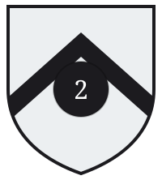 | [Fellow of the Open Craft](degree-02.md) | The Craft Lodge | Diligence | Fellowcraft | 30 |
| 3 | 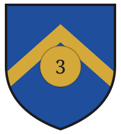 | [Master Builder](degree-03.md) | The Craft Lodge | Fidelity | Master Mason | 90 |
| 4 | 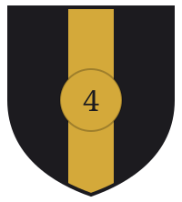 | [Keeper of Discretion](degree-04.md) | The Lodge of Perfection | Discretion | Secret Master | 270 |
| 5 | 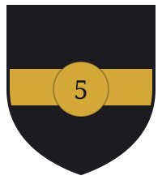 | [Steward of Memory](degree-05.md) | The Lodge of Perfection | Gratitude | Perfect Master | 300 |
| 6 | 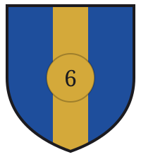 | [Scribe of Trust](degree-06.md) | The Lodge of Perfection | Faithfulness | Intimate Secretary | 330 |
| 7 | 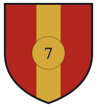 | [Arbiter](degree-07.md) | The Lodge of Perfection | Justice | Provost and Judge | 360 |
| 8 | 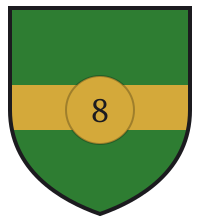 | [Intendant of the Works](degree-08.md) | The Lodge of Perfection | Diligence in service | Intendant of the Building | 390 |
| 9 | 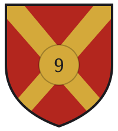 | [Elect of the Nine](degree-09.md) | The Lodge of Perfection | Restraint | Elu of the Nine | 420 |
| 10 | 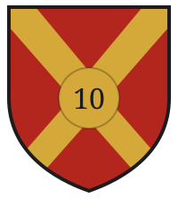 | [Elect of the Fifteen](degree-10.md) | The Lodge of Perfection | Tolerance | Elu of the Fifteen | 450 |
| 11 | 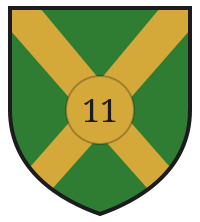 | [Elect of the Twelve](degree-11.md) | The Lodge of Perfection | Equity | Elu of the Twelve | 480 |
| 12 | 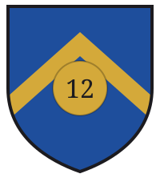 | [Master Architect](degree-12.md) | The Lodge of Perfection | Prudence | Master Architect | 510 |
| 13 | 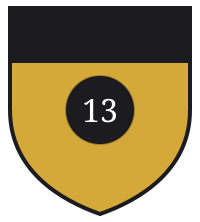 | [Seeker of the Vault](degree-13.md) | The Lodge of Perfection | Perseverance | Royal Arch of Solomon | 540 |
| 14 | 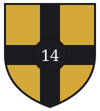 | [Perfect Elect](degree-14.md) | The Lodge of Perfection | Integrity | Perfect Elu (Grand Elect, Perfect and Sublime Mason) | 570 |
| 15 | 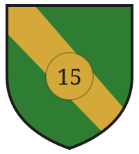 | [Knight of the East, the Rebuilder](degree-15.md) | The Chapter of the Rose | Loyalty to the work | Knight of the East (or of the Sword) | 750 |
| 16 | 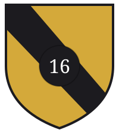 | [Prince of the Rebuilt City](degree-16.md) | The Chapter of the Rose | Civic courage | Prince of Jerusalem | 810 |
| 17 | 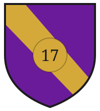 | [Knight of East and West](degree-17.md) | The Chapter of the Rose | Universality | Knight of the East and West | 870 |
| 18 | 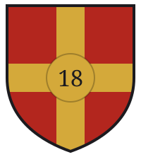 | [Knight of the Rose](degree-18.md) | The Chapter of the Rose | Charity | Knight Rose Croix | 930 |
| 19 | 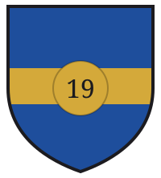 | [Pontifex, Bridge Builder](degree-19.md) | The Council of Kadosh | Concord | Grand Pontiff | 1,295 |
| 20 | 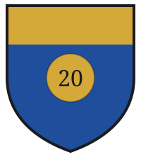 | [Master of the Symbolic Lodge](degree-20.md) | The Council of Kadosh | Patience | Master of the Symbolic Lodge | 1,355 |
| 21 | 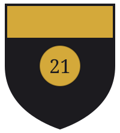 | [Noachite, Keeper of Humility](degree-21.md) | The Council of Kadosh | Humility before the law | Noachite, or Prussian Knight | 1,415 |
| 22 | 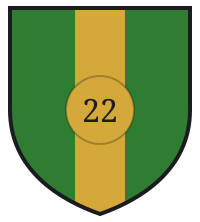 | [Knight of the Royal Axe, Dignity of Labor](degree-22.md) | The Council of Kadosh | Respect for work | Knight of the Royal Axe, or Prince of Libanus | 1,475 |
| 23 | 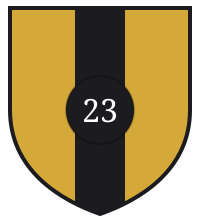 | [Chief of the Tabernacle, Servant of Rites](degree-23.md) | The Council of Kadosh | Reverence | Chief of the Tabernacle | 1,535 |
| 24 | 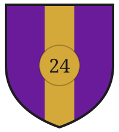 | [Prince of the Tabernacle, Interpreter of Symbols](degree-24.md) | The Council of Kadosh | Understanding | Prince of the Tabernacle | 1,595 |
| 25 | 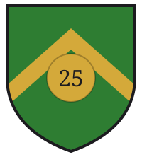 | [Knight of the Brazen Serpent, the Healer](degree-25.md) | The Council of Kadosh | Compassion | Knight of the Brazen Serpent | 1,655 |
| 26 | 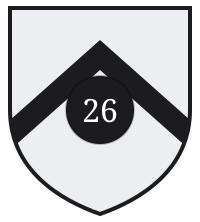 | [Prince of Mercy](degree-26.md) | The Council of Kadosh | Mercy | Prince of Mercy, or Scottish Trinitarian | 1,715 |
| 27 | 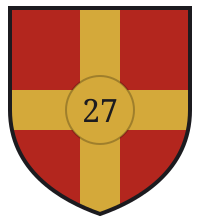 | [Commander of the Temple](degree-27.md) | The Council of Kadosh | Servant leadership | Knight Commander of the Temple | 1,775 |
| 28 | 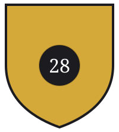 | [Knight of the Sun, Natural Philosopher](degree-28.md) | The Council of Kadosh | Truthfulness | Knight of the Sun, or Prince Adept | 1,835 |
| 29 | 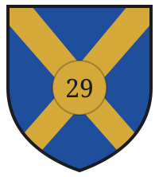 | [Knight of Saint Andrew, Equality](degree-29.md) | The Council of Kadosh | Equality | Scottish Knight of Saint Andrew | 1,895 |
| 30 | 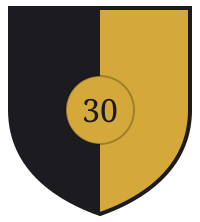 | [Kadosh, Guardian against Capture](degree-30.md) | The Council of Kadosh | Vigilance | Knight Kadosh, or Knight of the White and Black Eagle | 1,955 |
| 31 | 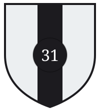 | [Inspector Inquisitor, the Auditor](degree-31.md) | The Consistory | Impartiality | Inspector Inquisitor | 2,320 |
| 32 | 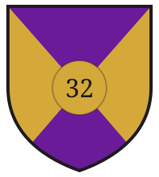 | [Master of the Royal Secret, Equilibrium](degree-32.md) | The Consistory | Balance | Master of the Royal Secret | 2,685 |
| 33 | 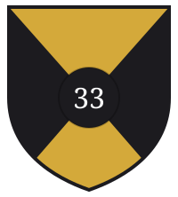 | [Sovereign Guardian](degree-33.md) | The Supreme Council | Self-limitation | Inspector General (honorary, conferred by a Supreme Council) | 3,415 |
