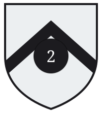

# 2°: Fellow of the Open Craft

**House:** The Craft Lodge. Self-knowledge and the tools of the work.  
**Historical reference:** Fellowcraft *(Ancient and Accepted Scottish Rite, Southern Jurisdiction; reference only; no ritual reproduced)*  
**Virtue:** Diligence  
**Art (field of study):** Logic, Arithmetic and Geometry: the seven liberal arts as method

> Knowledge that is not shared is a debt, not a possession.

## Requirements

- **Masterwork:** One contribution to the commons (code, translation, essay or catalog entry), accepted by the normal review of the resource it joins, examined by two members drawn by lot
- **Waiting period:** at least 30 days in the previous degree
- **Examiners drawn by lot:** 2
- **From admission:** at least 30 days of waiting, plus the time the examinations and ballots on the way take

## What it unlocks

Review Apprentice work, vote on admissions, examine candidates for the 2nd degree when drawn by lot. Degrees grant *duties and eligibility*, never extra votes (Landmark IV).

## Blazon

Field *argent*, ordinary *chevron*, charge *level* (rendered as the degree numeral).

← [1°](degree-01.md) · [all degrees](README.md) · [3°](degree-03.md) →
