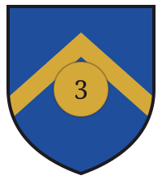

# 3°: Master Builder

**House:** The Craft Lodge. Self-knowledge and the tools of the work.  
**Historical reference:** Master Mason *(Ancient and Accepted Scottish Rite, Southern Jurisdiction; reference only; no ritual reproduced)*  
**Virtue:** Fidelity  
**Art (field of study):** Music and Astronomy: harmony, cycles and the measure of a life

> The temple is never finished; the builder is measured by what outlives them.

## Requirements

- **Masterwork:** A substantive masterwork (2,000+ words or equivalent work), defended before three examiners: public written questions and answers in the masterwork's public thread, never in a room
- **Waiting period:** at least 60 days in the previous degree
- **Examiners drawn by lot:** 3
- **From admission:** at least 90 days of waiting, plus the time the examinations and ballots on the way take

## What it unlocks

Sponsor candidates; examine candidates for the 2nd and 3rd degrees when drawn by lot, and for any higher degree whose own members are too few; be elected to Lodge office; found a Lodge. Degrees grant *duties and eligibility*, never extra votes (Landmark IV).

## Blazon

Field *azure*, ordinary *chevron*, charge *compass* (rendered as the degree numeral).

← [2°](degree-02.md) · [all degrees](README.md) · [4°](degree-04.md) →
