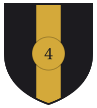

# 4°: Keeper of Discretion

**House:** The Lodge of Perfection. Duty, stewardship and justice inside the community.  
**Historical reference:** Secret Master *(Ancient and Accepted Scottish Rite, Southern Jurisdiction; reference only; no ritual reproduced)*  
**Virtue:** Discretion  
**Art (field of study):** Ethics of information: privacy, confidentiality and the duty of silence

> A secret that protects a person is a trust; a secret that protects power is a lie.

## Requirements

- **Masterwork:** A privacy review of one OpenMasonry process, with findings filed as issues
- **Waiting period:** at least 180 days in the previous degree
- **Examiners drawn by lot:** 3
- **From admission:** at least 270 days of waiting, plus the time the examinations and ballots on the way take

## What it unlocks

Serve as a teller of sealed ballots, once encrypted ballots exist. Degrees grant *duties and eligibility*, never extra votes (Landmark IV).

## Blazon

Field *sable*, ordinary *pale*, charge *key* (rendered as the degree numeral).

← [3°](degree-03.md) · [all degrees](README.md) · [5°](degree-05.md) →
