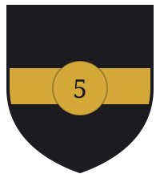

# 5°: Steward of Memory

**House:** The Lodge of Perfection. Duty, stewardship and justice inside the community.  
**Historical reference:** Perfect Master *(Ancient and Accepted Scottish Rite, Southern Jurisdiction; reference only; no ritual reproduced)*  
**Virtue:** Gratitude  
**Art (field of study):** History and archives: honoring those who built before us

> We stand on unmarked foundations; name them.

## Requirements

- **Masterwork:** An archive entry documenting a person, lodge or idea from the history of fraternal societies, with sources
- **Waiting period:** at least 30 days in the previous degree
- **Examiners drawn by lot:** 3
- **From admission:** at least 300 days of waiting, plus the time the examinations and ballots on the way take

## What it unlocks

Curate the History catalog. Degrees grant *duties and eligibility*, never extra votes (Landmark IV).

## Blazon

Field *sable*, ordinary *fess*, charge *column* (rendered as the degree numeral).

← [4°](degree-04.md) · [all degrees](README.md) · [6°](degree-06.md) →
