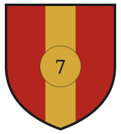

# 7°: Arbiter

**House:** The Lodge of Perfection. Duty, stewardship and justice inside the community.  
**Historical reference:** Provost and Judge *(Ancient and Accepted Scottish Rite, Southern Jurisdiction; reference only; no ritual reproduced)*  
**Virtue:** Justice  
**Art (field of study):** Dispute resolution: hearing both sides, evidence and proportionality

> Judge the act, not the person; judge yourself first.

## Requirements

- **Masterwork:** Serve as an observer in one dispute and write a reasoned opinion
- **Waiting period:** at least 30 days in the previous degree
- **Examiners drawn by lot:** 3
- **From admission:** at least 360 days of waiting, plus the time the examinations and ballots on the way take

## What it unlocks

Sit on dispute juries. Degrees grant *duties and eligibility*, never extra votes (Landmark IV).

## Blazon

Field *gules*, ordinary *pale*, charge *balance* (rendered as the degree numeral).

← [6°](degree-06.md) · [all degrees](README.md) · [8°](degree-08.md) →
