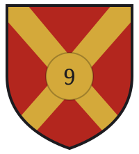

# 9°: Elect of the Nine

**House:** The Lodge of Perfection. Duty, stewardship and justice inside the community.  
**Historical reference:** Elu of the Nine *(Ancient and Accepted Scottish Rite, Southern Jurisdiction; reference only; no ritual reproduced)*  
**Virtue:** Restraint  
**Art (field of study):** Incident response: acting under provocation without vengeance

> Zeal without restraint is the first apprentice of tyranny.

## Requirements

- **Masterwork:** Write or improve an incident-response runbook and run a tabletop exercise
- **Waiting period:** at least 30 days in the previous degree
- **Examiners drawn by lot:** 3
- **From admission:** at least 420 days of waiting, plus the time the examinations and ballots on the way take

## What it unlocks

Join the incident rota. Degrees grant *duties and eligibility*, never extra votes (Landmark IV).

## Blazon

Field *gules*, ordinary *saltire*, charge *lamp* (rendered as the degree numeral).

← [8°](degree-08.md) · [all degrees](README.md) · [10°](degree-10.md) →
