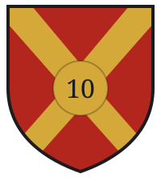

# 10°: Elect of the Fifteen

**House:** The Lodge of Perfection. Duty, stewardship and justice inside the community.  
**Historical reference:** Elu of the Fifteen *(Ancient and Accepted Scottish Rite, Southern Jurisdiction; reference only; no ritual reproduced)*  
**Virtue:** Tolerance  
**Art (field of study):** Moderation: protecting dialogue from fanaticism, harassment and bad faith

> Tolerate persons, never the abolition of tolerance.

## Requirements

- **Masterwork:** Moderate a public forum of OpenMasonry or another community for 60 days with a published moderation log
- **Waiting period:** at least 30 days in the previous degree
- **Examiners drawn by lot:** 3
- **From admission:** at least 450 days of waiting, plus the time the examinations and ballots on the way take

## What it unlocks

Become a forum moderator. Degrees grant *duties and eligibility*, never extra votes (Landmark IV).

## Blazon

Field *gules*, ordinary *saltire*, charge *star* on a roundel.

← [9°](degree-09.md) · [all degrees](README.md) · [11°](degree-11.md) →
