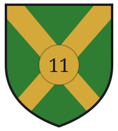

# 11°: Elect of the Twelve

**House:** The Lodge of Perfection. Duty, stewardship and justice inside the community.  
**Historical reference:** Elu of the Twelve *(Ancient and Accepted Scottish Rite, Southern Jurisdiction; reference only; no ritual reproduced)*  
**Virtue:** Equity  
**Art (field of study):** Economics of the commons: Ostrom's principles, free riding and fair burdens

> A commons dies of silence before it dies of theft.

## Requirements

- **Masterwork:** A commons-health report on one OpenMasonry resource, scored against Ostrom's eight principles
- **Waiting period:** at least 30 days in the previous degree
- **Examiners drawn by lot:** 3
- **From admission:** at least 480 days of waiting, plus the time the examinations and ballots on the way take

## What it unlocks

Review proposed amendments to operational rules for their effect on the commons. Degrees grant *duties and eligibility*, never extra votes (Landmark IV).

## Blazon

Field *vert*, ordinary *saltire*, charge *sheaf* (rendered as the degree numeral).

← [10°](degree-10.md) · [all degrees](README.md) · [12°](degree-12.md) →
