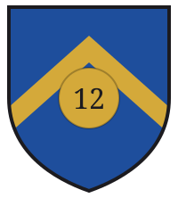

# 12°: Master Architect

**House:** The Lodge of Perfection. Duty, stewardship and justice inside the community.  
**Historical reference:** Master Architect *(Ancient and Accepted Scottish Rite, Southern Jurisdiction; reference only; no ritual reproduced)*  
**Virtue:** Prudence  
**Art (field of study):** System design: geometry of structures, failure modes and simplicity

> Design so that the next builder can change what you built.

## Requirements

- **Masterwork:** An architecture decision record (ADR) accepted into the canonical repository
- **Waiting period:** at least 30 days in the previous degree
- **Examiners drawn by lot:** 3
- **From admission:** at least 510 days of waiting, plus the time the examinations and ballots on the way take

## What it unlocks

Review protocol-code amendments before their ballot (advisory). Degrees grant *duties and eligibility*, never extra votes (Landmark IV).

## Blazon

Field *azure*, ordinary *chevron*, charge *square* on a roundel.

← [11°](degree-11.md) · [all degrees](README.md) · [13°](degree-13.md) →
