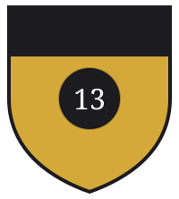

# 13°: Seeker of the Vault

**House:** The Lodge of Perfection. Duty, stewardship and justice inside the community.  
**Historical reference:** Royal Arch of Solomon *(Ancient and Accepted Scottish Rite, Southern Jurisdiction; reference only; no ritual reproduced)*  
**Virtue:** Perseverance  
**Art (field of study):** Research: first principles, primary sources and the patience to dig

> What is buried is not lost to the one who keeps digging honestly.

## Requirements

- **Masterwork:** A research paper with primary sources, examined as drawn by lot
- **Waiting period:** at least 30 days in the previous degree
- **Examiners drawn by lot:** 3
- **From admission:** at least 540 days of waiting, plus the time the examinations and ballots on the way take

## What it unlocks

Supervise research circles. Degrees grant *duties and eligibility*, never extra votes (Landmark IV).

## Blazon

Field *or*, ordinary *chief*, charge *arch* on a roundel.

← [12°](degree-12.md) · [all degrees](README.md) · [14°](degree-14.md) →
