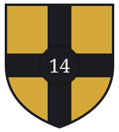

# 14°: Perfect Elect

**House:** The Lodge of Perfection. Duty, stewardship and justice inside the community.  
**Historical reference:** Perfect Elu (Grand Elect, Perfect and Sublime Mason) *(Ancient and Accepted Scottish Rite, Southern Jurisdiction; reference only; no ritual reproduced)*  
**Virtue:** Integrity  
**Art (field of study):** Synthesis of the Perfection: the self as the first commons

> Integrity is the same person in the dark and in the light.

## Requirements

- **Masterwork:** A public synthesis of degrees 4–13 and a service record: signed work entries or public records of service over at least 365 days
- **Waiting period:** at least 30 days in the previous degree
- **Examiners drawn by lot:** 5
- **From admission:** at least 570 days of waiting, plus the time the examinations and ballots on the way take

## What it unlocks

Preside over a Lodge of Perfection. Degrees grant *duties and eligibility*, never extra votes (Landmark IV).

## Blazon

Field *or*, ordinary *cross*, charge *ring* (rendered as the degree numeral).

← [13°](degree-13.md) · [all degrees](README.md) · [15°](degree-15.md) →
