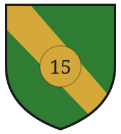

# 15°: Knight of the East, the Rebuilder

**House:** The Chapter of the Rose. Rebuilding, liberty of conscience and active charity.  
**Historical reference:** Knight of the East (or of the Sword) *(Ancient and Accepted Scottish Rite, Southern Jurisdiction; reference only; no ritual reproduced)*  
**Virtue:** Loyalty to the work  
**Art (field of study):** Resilience: backups, mirrors, recovery and continuity

> Build with a trowel in one hand and a backup in the other.

## Requirements

- **Masterwork:** Operate a verified mirror of the canonical repository for 90 days
- **Waiting period:** at least 180 days in the previous degree
- **Examiners drawn by lot:** 3
- **From admission:** at least 750 days of waiting, plus the time the examinations and ballots on the way take

## What it unlocks

Operate an official mirror. Degrees grant *duties and eligibility*, never extra votes (Landmark IV).

## Blazon

Field *vert*, ordinary *bend*, charge *sword* on a roundel.

← [14°](degree-14.md) · [all degrees](README.md) · [16°](degree-16.md) →
