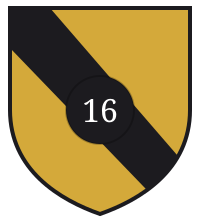

# 16°: Prince of the Rebuilt City

**House:** The Chapter of the Rose. Rebuilding, liberty of conscience and active charity.  
**Historical reference:** Prince of Jerusalem *(Ancient and Accepted Scottish Rite, Southern Jurisdiction; reference only; no ritual reproduced)*  
**Virtue:** Civic courage  
**Art (field of study):** Civic governance: assemblies, mandates and accountability

> A city is rebuilt by citizens, not by princes.

## Requirements

- **Masterwork:** Organize and document one assembly, with minutes published in the repository
- **Waiting period:** at least 60 days in the previous degree
- **Examiners drawn by lot:** 3
- **From admission:** at least 810 days of waiting, plus the time the examinations and ballots on the way take

## What it unlocks

Convene assemblies. Degrees grant *duties and eligibility*, never extra votes (Landmark IV).

## Blazon

Field *or*, ordinary *bend*, charge *tower* on a roundel.

← [15°](degree-15.md) · [all degrees](README.md) · [17°](degree-17.md) →
