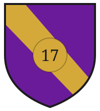

# 17°: Knight of East and West

**House:** The Chapter of the Rose. Rebuilding, liberty of conscience and active charity.  
**Historical reference:** Knight of the East and West *(Ancient and Accepted Scottish Rite, Southern Jurisdiction; reference only; no ritual reproduced)*  
**Virtue:** Universality  
**Art (field of study):** Comparative traditions: philosophies, religions and cultures in dialogue

> No single tradition owns the light; each one carries a lamp.

## Requirements

- **Masterwork:** A comparative study across at least three traditions, published in its original language and in one translation into a second language
- **Waiting period:** at least 60 days in the previous degree
- **Examiners drawn by lot:** 3
- **From admission:** at least 870 days of waiting, plus the time the examinations and ballots on the way take

## What it unlocks

Lead translation and outreach programs. Degrees grant *duties and eligibility*, never extra votes (Landmark IV).

## Blazon

Field *purpure*, ordinary *bend*, charge *sun-moon* on a roundel.

← [16°](degree-16.md) · [all degrees](README.md) · [18°](degree-18.md) →
