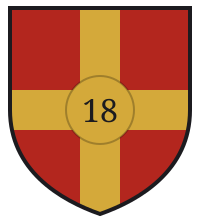

# 18°: Knight of the Rose

**House:** The Chapter of the Rose. Rebuilding, liberty of conscience and active charity.  
**Historical reference:** Knight Rose Croix *(Ancient and Accepted Scottish Rite, Southern Jurisdiction; reference only; no ritual reproduced)*  
**Virtue:** Charity  
**Art (field of study):** Active benevolence: mentoring, relief and the ethics of care

> Love that does not act is only a feeling about oneself.

## Requirements

- **Masterwork:** Mentor two Apprentices to the degree of Fellow and lead one relief action
- **Waiting period:** at least 60 days in the previous degree
- **Examiners drawn by lot:** 5
- **From admission:** at least 930 days of waiting, plus the time the examinations and ballots on the way take

## What it unlocks

Preside over a Chapter of the Rose; administer the relief fund, where one exists. Degrees grant *duties and eligibility*, never extra votes (Landmark IV).

## Blazon

Field *gules*, ordinary *cross*, charge *rose* (rendered as the degree numeral).

← [17°](degree-17.md) · [all degrees](README.md) · [19°](degree-19.md) →
