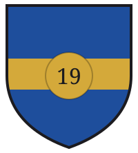

# 19°: Pontifex, Bridge Builder

**House:** The Council of Kadosh. Philosophy, law, and the defense of the commons against capture.  
**Historical reference:** Grand Pontiff *(Ancient and Accepted Scottish Rite, Southern Jurisdiction; reference only; no ritual reproduced)*  
**Virtue:** Concord  
**Art (field of study):** Federation: interoperability between Lodges, nodes and other communities

> Build bridges you are willing to cross in both directions.

## Requirements

- **Masterwork:** Federate a witness node, or a new Lodge when lodges exist, with interoperability tests
- **Waiting period:** at least 365 days in the previous degree
- **Examiners drawn by lot:** 3
- **From admission:** at least 1,295 days of waiting, plus the time the examinations and ballots on the way take

## What it unlocks

Approve federation of new Lodges, when lodges exist. Degrees grant *duties and eligibility*, never extra votes (Landmark IV).

## Blazon

Field *azure*, ordinary *fess*, charge *bridge* (rendered as the degree numeral).

← [18°](degree-18.md) · [all degrees](README.md) · [20°](degree-20.md) →
