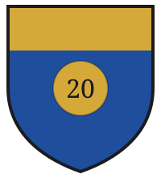

# 20°: Master of the Symbolic Lodge

**House:** The Council of Kadosh. Philosophy, law, and the defense of the commons against capture.  
**Historical reference:** Master of the Symbolic Lodge *(Ancient and Accepted Scottish Rite, Southern Jurisdiction; reference only; no ritual reproduced)*  
**Virtue:** Patience  
**Art (field of study):** Pedagogy: how adults learn, and how to teach without dominating

> The master's work is complete when the apprentice no longer needs the master.

## Requirements

- **Masterwork:** Design or substantially improve one degree's study curriculum
- **Waiting period:** at least 60 days in the previous degree
- **Examiners drawn by lot:** 3
- **From admission:** at least 1,355 days of waiting, plus the time the examinations and ballots on the way take

## What it unlocks

Author curricula; train examiners. Degrees grant *duties and eligibility*, never extra votes (Landmark IV).

## Blazon

Field *azure*, ordinary *chief*, charge *book* on a roundel.

← [19°](degree-19.md) · [all degrees](README.md) · [21°](degree-21.md) →
