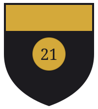

# 21°: Noachite, Keeper of Humility

**House:** The Council of Kadosh. Philosophy, law, and the defense of the commons against capture.  
**Historical reference:** Noachite, or Prussian Knight *(Ancient and Accepted Scottish Rite, Southern Jurisdiction; reference only; no ritual reproduced)*  
**Virtue:** Humility before the law  
**Art (field of study):** Universal ethics and precedent: laws every person can accept

> The higher you stand, the lower the law must find you.

## Requirements

- **Masterwork:** A precedent digest: summarize up to ten rulings from the public record, or all if fewer, and the principles they set
- **Waiting period:** at least 60 days in the previous degree
- **Examiners drawn by lot:** 3
- **From admission:** at least 1,415 days of waiting, plus the time the examinations and ballots on the way take

## What it unlocks

Maintain the book of precedents. Degrees grant *duties and eligibility*, never extra votes (Landmark IV).

## Blazon

Field *sable*, ordinary *chief*, charge *ark* (rendered as the degree numeral).

← [20°](degree-20.md) · [all degrees](README.md) · [22°](degree-22.md) →
