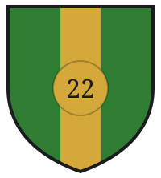

# 22°: Knight of the Royal Axe, Dignity of Labor

**House:** The Council of Kadosh. Philosophy, law, and the defense of the commons against capture.  
**Historical reference:** Knight of the Royal Axe, or Prince of Libanus *(Ancient and Accepted Scottish Rite, Southern Jurisdiction; reference only; no ritual reproduced)*  
**Virtue:** Respect for work  
**Art (field of study):** Sustainability of labor: maintainers, burnout and fair recognition

> Honor the hands that cut the cedar, not only the names carved on it.

## Requirements

- **Masterwork:** A recognition audit: identify and credit uncredited contributors
- **Waiting period:** at least 60 days in the previous degree
- **Examiners drawn by lot:** 3
- **From admission:** at least 1,475 days of waiting, plus the time the examinations and ballots on the way take

## What it unlocks

Run the contributor-recognition rota. Degrees grant *duties and eligibility*, never extra votes (Landmark IV).

## Blazon

Field *vert*, ordinary *pale*, charge *axe* (rendered as the degree numeral).

← [21°](degree-21.md) · [all degrees](README.md) · [23°](degree-23.md) →
