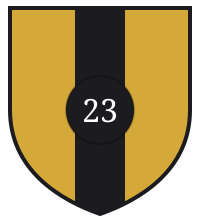

# 23°: Chief of the Tabernacle, Servant of Rites

**House:** The Council of Kadosh. Philosophy, law, and the defense of the commons against capture.  
**Historical reference:** Chief of the Tabernacle *(Ancient and Accepted Scottish Rite, Southern Jurisdiction; reference only; no ritual reproduced)*  
**Virtue:** Reverence  
**Art (field of study):** Ceremony design: ritual as shared meaning and as user experience

> A rite that no longer teaches has become a costume.

## Requirements

- **Masterwork:** Write or revise an open ceremony (public, original text)
- **Waiting period:** at least 60 days in the previous degree
- **Examiners drawn by lot:** 3
- **From admission:** at least 1,535 days of waiting, plus the time the examinations and ballots on the way take

## What it unlocks

Edit the open ritual book. Degrees grant *duties and eligibility*, never extra votes (Landmark IV).

## Blazon

Field *or*, ordinary *pale*, charge *flame* on a roundel.

← [22°](degree-22.md) · [all degrees](README.md) · [24°](degree-24.md) →
