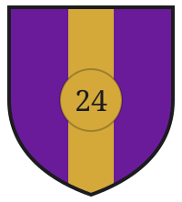

# 24°: Prince of the Tabernacle, Interpreter of Symbols

**House:** The Council of Kadosh. Philosophy, law, and the defense of the commons against capture.  
**Historical reference:** Prince of the Tabernacle *(Ancient and Accepted Scottish Rite, Southern Jurisdiction; reference only; no ritual reproduced)*  
**Virtue:** Understanding  
**Art (field of study):** Semiotics: symbols, allegory and their many honest readings

> A symbol is a question that each generation must answer again.

## Requirements

- **Masterwork:** Ten entries in the Symbols catalog with sources and multiple interpretations
- **Waiting period:** at least 60 days in the previous degree
- **Examiners drawn by lot:** 3
- **From admission:** at least 1,595 days of waiting, plus the time the examinations and ballots on the way take

## What it unlocks

Curate the Symbols catalog. Degrees grant *duties and eligibility*, never extra votes (Landmark IV).

## Blazon

Field *purpure*, ordinary *pale*, charge *triangle* (rendered as the degree numeral).

← [23°](degree-23.md) · [all degrees](README.md) · [25°](degree-25.md) →
