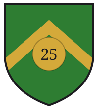

# 25°: Knight of the Brazen Serpent, the Healer

**House:** The Council of Kadosh. Philosophy, law, and the defense of the commons against capture.  
**Historical reference:** Knight of the Brazen Serpent *(Ancient and Accepted Scottish Rite, Southern Jurisdiction; reference only; no ritual reproduced)*  
**Virtue:** Compassion  
**Art (field of study):** Wellbeing: mental health, burnout and care inside communities

> Heal the one in front of you before you theorize about the many.

## Requirements

- **Masterwork:** Build or improve a wellbeing support process and train five members in it
- **Waiting period:** at least 60 days in the previous degree
- **Examiners drawn by lot:** 3
- **From admission:** at least 1,655 days of waiting, plus the time the examinations and ballots on the way take

## What it unlocks

Serve as wellbeing steward. Degrees grant *duties and eligibility*, never extra votes (Landmark IV).

## Blazon

Field *vert*, ordinary *chevron*, charge *serpent* (rendered as the degree numeral).

← [24°](degree-24.md) · [all degrees](README.md) · [26°](degree-26.md) →
