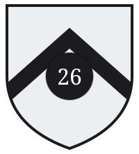

# 26°: Prince of Mercy

**House:** The Council of Kadosh. Philosophy, law, and the defense of the commons against capture.  
**Historical reference:** Prince of Mercy, or Scottish Trinitarian *(Ancient and Accepted Scottish Rite, Southern Jurisdiction; reference only; no ritual reproduced)*  
**Virtue:** Mercy  
**Art (field of study):** Restorative justice: repair, amnesty and the return of the excluded

> Justice that cannot forgive is only accounting.

## Requirements

- **Masterwork:** Facilitate one restorative process or reinstatement review
- **Waiting period:** at least 60 days in the previous degree
- **Examiners drawn by lot:** 3
- **From admission:** at least 1,715 days of waiting, plus the time the examinations and ballots on the way take

## What it unlocks

Grant clemency petitions a hearing. Degrees grant *duties and eligibility*, never extra votes (Landmark IV).

## Blazon

Field *argent*, ordinary *chevron*, charge *heart* (rendered as the degree numeral).

← [25°](degree-25.md) · [all degrees](README.md) · [27°](degree-27.md) →
