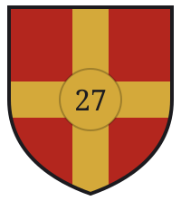

# 27°: Commander of the Temple

**House:** The Council of Kadosh. Philosophy, law, and the defense of the commons against capture.  
**Historical reference:** Knight Commander of the Temple *(Ancient and Accepted Scottish Rite, Southern Jurisdiction; reference only; no ritual reproduced)*  
**Virtue:** Servant leadership  
**Art (field of study):** Leadership: responsibility without privilege, authority without ownership

> Command is a debt you pay to those who follow.

## Requirements

- **Masterwork:** Hold an elected office for a full term with a public accountability report
- **Waiting period:** at least 60 days in the previous degree
- **Examiners drawn by lot:** 3
- **From admission:** at least 1,775 days of waiting, plus the time the examinations and ballots on the way take

## What it unlocks

Stand for House-level office. Degrees grant *duties and eligibility*, never extra votes (Landmark IV).

## Blazon

Field *gules*, ordinary *cross*, charge *cross-potent* on a roundel.

← [26°](degree-26.md) · [all degrees](README.md) · [28°](degree-28.md) →
