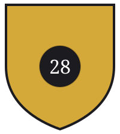

# 28°: Knight of the Sun, Natural Philosopher

**House:** The Council of Kadosh. Philosophy, law, and the defense of the commons against capture.  
**Historical reference:** Knight of the Sun, or Prince Adept *(Ancient and Accepted Scottish Rite, Southern Jurisdiction; reference only; no ritual reproduced)*  
**Virtue:** Truthfulness  
**Art (field of study):** Science and epistemology: evidence, doubt and the limits of knowing

> Doubt is the lantern; certainty is where the lantern goes out.

## Requirements

- **Masterwork:** An evidence review that recommends changing or confirming one OpenMasonry rule (an amendment it proposes need not pass)
- **Waiting period:** at least 60 days in the previous degree
- **Examiners drawn by lot:** 3
- **From admission:** at least 1,835 days of waiting, plus the time the examinations and ballots on the way take

## What it unlocks

Chair evidence reviews. Degrees grant *duties and eligibility*, never extra votes (Landmark IV).

## Blazon

Field *or*, ordinary *plain*, charge *sun* (rendered as the degree numeral).

← [27°](degree-27.md) · [all degrees](README.md) · [29°](degree-29.md) →
