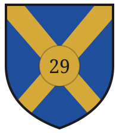

# 29°: Knight of Saint Andrew, Equality

**House:** The Council of Kadosh. Philosophy, law, and the defense of the commons against capture.  
**Historical reference:** Scottish Knight of Saint Andrew *(Ancient and Accepted Scottish Rite, Southern Jurisdiction; reference only; no ritual reproduced)*  
**Virtue:** Equality  
**Art (field of study):** Accessibility and non-discrimination: the open door kept open

> Every locked door was once called a tradition.

## Requirements

- **Masterwork:** An accessibility and inclusion audit of the whole admission path
- **Waiting period:** at least 60 days in the previous degree
- **Examiners drawn by lot:** 3
- **From admission:** at least 1,895 days of waiting, plus the time the examinations and ballots on the way take

## What it unlocks

Raise an equality objection: refer to the Court of Review any rule that refuses or ranks anyone for sex, gender, origin, color, belief or unbelief, class or disability. Degrees grant *duties and eligibility*, never extra votes (Landmark IV).

## Blazon

Field *azure*, ordinary *saltire*, charge *saltire-cross* (rendered as the degree numeral).

← [28°](degree-28.md) · [all degrees](README.md) · [30°](degree-30.md) →
