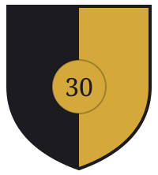

# 30°: Kadosh, Guardian against Capture

**House:** The Council of Kadosh. Philosophy, law, and the defense of the commons against capture.  
**Historical reference:** Knight Kadosh, or Knight of the White and Black Eagle *(Ancient and Accepted Scottish Rite, Southern Jurisdiction; reference only; no ritual reproduced)*  
**Virtue:** Vigilance  
**Art (field of study):** Adversarial thinking: security, red-teaming and the anatomy of tyranny

> Every institution is one quiet exception away from becoming what it opposed.

## Requirements

- **Masterwork:** A red-team report against the protocol with at least one fixed finding
- **Waiting period:** at least 60 days in the previous degree
- **Examiners drawn by lot:** 5
- **From admission:** at least 1,955 days of waiting, plus the time the examinations and ballots on the way take

## What it unlocks

Join the Watch (security response team); answer capture alarms. Degrees grant *duties and eligibility*, never extra votes (Landmark IV).

## Blazon

Field *sable*, ordinary *per-pale*, charge *eagle* (rendered as the degree numeral).

← [29°](degree-29.md) · [all degrees](README.md) · [31°](degree-31.md) →
