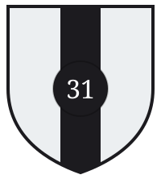

# 31°: Inspector Inquisitor, the Auditor

**House:** The Consistory. Audit, judgment and the balance of powers.  
**Historical reference:** Inspector Inquisitor *(Ancient and Accepted Scottish Rite, Southern Jurisdiction; reference only; no ritual reproduced)*  
**Virtue:** Impartiality  
**Art (field of study):** Audit and judicial review: checking the powerful with their own rules

> Audit the auditors, beginning with yourself.

## Requirements

- **Masterwork:** A full annual audit of one House, published with dissent sections
- **Waiting period:** at least 365 days in the previous degree
- **Examiners drawn by lot:** 5
- **From admission:** at least 2,320 days of waiting, plus the time the examinations and ballots on the way take

## What it unlocks

Sit on the Court of Review. Degrees grant *duties and eligibility*, never extra votes (Landmark IV).

## Blazon

Field *argent*, ordinary *pale*, charge *eye* on a roundel.

← [30°](degree-30.md) · [all degrees](README.md) · [32°](degree-32.md) →
