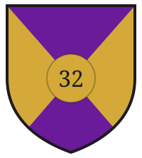

# 32°: Master of the Royal Secret, Equilibrium

**House:** The Consistory. Audit, judgment and the balance of powers.  
**Historical reference:** Master of the Royal Secret *(Ancient and Accepted Scottish Rite, Southern Jurisdiction; reference only; no ritual reproduced)*  
**Virtue:** Balance  
**Art (field of study):** Synthesis: the balance of powers and the equilibrium of opposites

> The royal secret is that no one should hold it alone.

## Requirements

- **Masterwork:** A thesis on the balance of powers in OpenMasonry, defended publicly: written questions and answers in its public thread, never in a room
- **Waiting period:** at least 365 days in the previous degree
- **Examiners drawn by lot:** 7
- **From admission:** at least 2,685 days of waiting, plus the time the examinations and ballots on the way take

## What it unlocks

Enter the sortition pool of the Supreme Council after 730 days in the degree. Degrees grant *duties and eligibility*, never extra votes (Landmark IV).

## Blazon

Field *purpure*, ordinary *per-saltire*, charge *double-eagle* on a roundel.

← [31°](degree-31.md) · [all degrees](README.md) · [33°](degree-33.md) →
