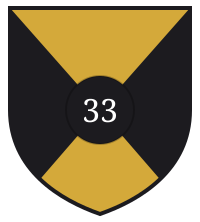

# 33°: Sovereign Guardian

**House:** The Supreme Council. Guardianship of the Constitution. Serves; never commands.  
**Historical reference:** Inspector General (honorary, conferred by a Supreme Council) *(Ancient and Accepted Scottish Rite, Southern Jurisdiction; reference only; no ritual reproduced)*  
**Virtue:** Self-limitation  
**Art (field of study):** Guardianship of the Constitution

> Guard the house so well that it never needs you.

## Requirements

- **Masterwork:** Not applied for. Drawn by verifiable lot from all eligible 32nd-degree members (Constitution Art. VIII)
- **Waiting period:** at least 730 days in the previous degree
- **Examiners drawn by lot:** 0
- **From admission:** at least 3,415 days of waiting, plus the time the examinations and ballots on the way take and the lot of the Supreme Council

## What it unlocks

A three-year, non-renewable seat on the Supreme Council. Degrees grant *duties and eligibility*, never extra votes (Landmark IV).

## Blazon

Field *or*, ordinary *per-saltire*, charge *delta* (rendered as the degree numeral).

[all degrees](README.md)
